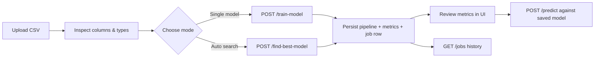
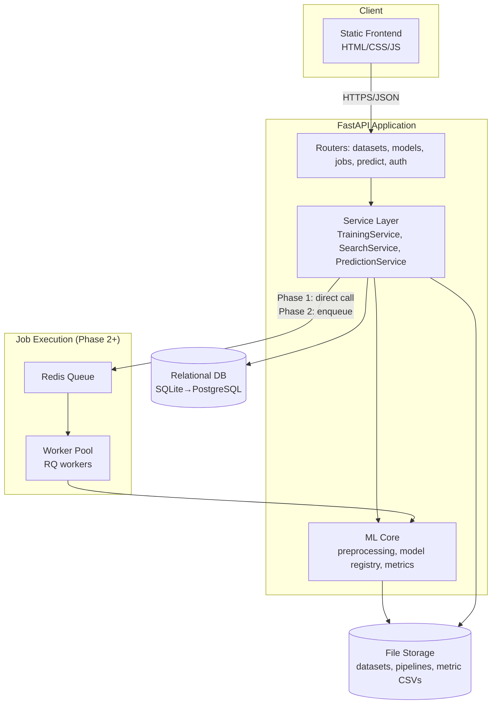
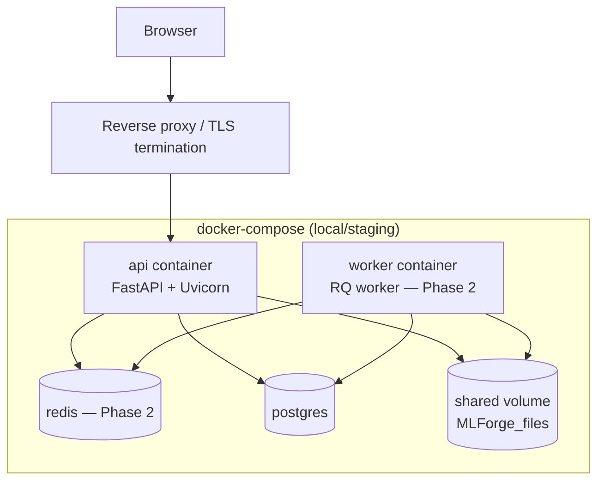
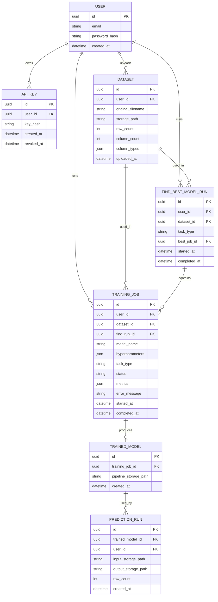

# MLForge — Product Requirements Document

**Document owner:** Product/Engineering
**Status:** Final (v1.0) — source of truth for implementation
**Date:** 2026-11-17
**Project type:** Brownfield (existing codebase evaluated and extended)

---

## 1. Executive Summary

MLForge is a self-service web platform that lets a user upload a tabular CSV dataset, choose input/target columns, and train a scikit-learn model — either a specific algorithm or an automatic "find the best model" search across 40+ candidate algorithms — without writing code. The system already exists as a working prototype: a FastAPI backend that shells out to a CLI training script, a flat-file persistence layer (CSV configs, pickled models, CSV metric reports), and a static HTML/CSS/JS frontend.

The prototype proves the core value proposition but has accumulated gaps that block real usage beyond a single trusted operator on one machine: a broken configuration path that makes the model catalog endpoint crash, no preprocessing pipeline (datasets must already be fully numeric), two frontend pages wired to backend endpoints that were never built (inference and training history), no persistence layer beyond the filesystem, no authentication, no job isolation between users, unbounded disk growth, and a training execution model (one OS subprocess per candidate model, run serially) that will not scale past a handful of concurrent users.

This PRD defines the target product: the same core workflow, hardened into a product a team can operate for multiple concurrent users, with the two broken frontend features implemented, a real data layer, basic security, and a phased roadmap that fixes correctness issues first and defers scale/multi-tenancy work to later, clearly-gated phases.

## 2. Product Vision

**Vision statement:** Anyone who can prepare a CSV file should be able to produce, evaluate, compare, and reuse a trained machine-learning model in minutes, without installing Python, writing code, or knowing which algorithm to pick.

MLForge sits between "write your own scikit-learn script" (too slow, requires ML knowledge) and "full MLOps platform" (too heavy for a small dataset and a single question: *is this predictable, and with what model?*). It optimizes for speed-to-first-model and transparent comparison across algorithms, not for large-scale production ML pipelines.

### 2.1 Core product principles

- **No-code, not low-insight.** Automating model selection must not hide *why* a model was chosen — metrics and comparisons are always shown.
- **CSV in, model out.** The dataset format is always a flat file; no streaming, no unstructured data, no images in this product's scope.
- **One algorithm family.** Classical ML (scikit-learn) only. Deep learning, AutoML with neural architecture search, and LLM-based tooling are explicitly out of scope.
- **Every trained model is reusable.** A model that isn't retrievable and usable for prediction later has no value — this was the biggest gap in the existing build and is corrected here.
- **Boring, debuggable infrastructure.** Flat files and a single relational database beat a distributed system for this problem size.

## 3. Problem Statement

Teams and individuals with a CSV of labeled data (e.g., invoice approval outcomes, attendance records, payment classifications — the kind of operational data seen in this project's own sample datasets) often need a quick answer to "can a simple ML model predict this column from the others, and how well?" Today that requires:

- Knowing Python and scikit-learn,
- Knowing which of 40+ algorithms is even applicable to the task type,
- Writing boilerplate for train/test split, metric computation, and model persistence,
- Re-deriving all of the above every time a new dataset shows up.

MLForge removes the coding step and the algorithm-selection guesswork, while keeping the output (metrics, a downloadable model) transparent and trustworthy enough to act on.

## 4. Objectives and Success Metrics

| Objective | Why it matters | Metric | Target |
|---|---|---|---|
| Fix the broken model catalog | `/models` currently throws because of a bad config path — the entire home-page workflow is unusable today | `/models` success rate | 100% (0 errors in steady state) |
| Make every trained model reusable | "Use Model" page exists in the UI with no backend; a model you can't run predictions with has no product value | % of trained models later used for a prediction via `/predict` | tracked from 0 → used as adoption signal |
| Support real-world (non-preprocessed) CSVs | Current pipeline fails on any non-numeric column | % of uploaded datasets that train successfully without manual pre-cleaning | ≥ 90% of datasets with ≤ 20% missing values and mixed numeric/categorical columns |
| Make "find best model" safe at scale | Today it serially spawns up to ~40 OS processes per request with no timeout | p95 latency for a 10-model, 10k-row search | ≤ 90 seconds |
| Eliminate unbounded disk growth | 70+ orphaned uploads and pickles already present with no cleanup | Disk used by orphaned (job-less) files older than retention window | 0, enforced by scheduled cleanup |
| Make the platform safe to expose beyond one trusted user | No auth, CORS wide open, stack traces returned to the client today | Unauthenticated requests to write endpoints | 0% succeed (Phase 2) |

## 5. Target Users and Personas

- **Data-literate analyst ("Priya"):** Comfortable with spreadsheets and basic statistics, not a programmer. Wants to drag in a CSV, pick a target column, and get a model plus a plain-language quality verdict ("Good", "Poor").
- **ML-aware engineer ("Daniel"):** Knows scikit-learn, wants to quickly benchmark many algorithms on a new dataset before writing a production pipeline elsewhere. Uses "Find Best Model" and downloads the pickle/metrics for further work.
- **Operations power-user ("Meera"):** Runs this repeatedly against similar recurring datasets (e.g., weekly attendance or invoice exports — reflected in this repo's own sample files). Cares about history/logs of past runs and about being able to re-run predictions against a previously trained model without retraining.

## 6. Existing System Assessment

This is a brownfield project. The assessment below distinguishes what exists and works, what exists but is broken or orphaned, and what the UI implies but the backend never implemented.

### 6.1 What exists and works today

- **FastAPI backend** (`api/main.py`) exposing `GET /`, `GET /models`, `POST /train-model`, `POST /find-best-model`, plus static mounts for the frontend and the `MLForge_files` data directory.
- **CLI training pipeline** in `src/` (`model.py` → `train.py` → `metrics.py`) that performs an 80/20 train/test split, fits a scikit-learn estimator, computes classification or regression metrics into a CSV, and pickles the fitted model. Invoked by the API via `subprocess.run([...])`, one OS process per training request.
- **Model catalog**: `MLForge_files/csv_configurations/model_capabilities.csv` lists 40+ scikit-learn classes with classification/regression applicability flags, driving the "allowed models" list for auto-search.
- **Frontend**: static HTML/CSS/vanilla JS pages — home/train (`index.html` + `app.js`), auto-search (`find-model.html` + `find-model.js`), and two results pages (`classification-analysis.html`, `regression-analysis.html`) that read results out of `sessionStorage` after a redirect.
- **Metrics**: classification report (precision/recall/F1/support/accuracy) and a full regression metric set (R², MAE, MSE, RMSE-equivalents, explained variance, deviances) are both implemented in `src/metrics.py`.

### 6.2 Defects in existing functionality (must fix, not rebuild)

| ID | Defect | Evidence | Impact |
|---|---|---|---|
| BUG-01 | `Config.CSV_CONFIG` ([src/config.py](src/config.py)) points to `MLForge_files/csv_configurations/MLForge_model_tbl.csv`, a file that does not exist. The actual file is `model_capabilities.csv`. | `GET /models` and the CLI `model.get_models()` both read `Config.CSV_CONFIG`. | **Critical.** `GET /models` throws `FileNotFoundError` today; the home page's model dropdown cannot populate, and single-model training via the UI is blocked. |
| BUG-02 | `api/find-best-model.py` is a dead, non-importable duplicate of the `/find-best-model` logic already in `main.py`. It references an undefined `app` at module scope and is never imported by `main.py`. | File inspection. | Dead code / maintenance hazard; must be deleted, not fixed. |
| BUG-03 | Task-type auto-detection (`detect_task_type` in `main.py`) is `nunique(target) <= 20 → classification`, else regression. | `api/main.py` | Misclassifies integer-valued regression targets with few distinct values, and misclassifies high-cardinality classification targets (>20 classes) as regression. |
| BUG-04 | `model_params` is parsed via `json.loads(model_params.replace('$','"'))` — a workaround for quoting issues rather than well-formed JSON input. | `src/model.py` | Fragile; silently mis-parses parameter values containing a literal `$`. |
| BUG-05 | Server-side `stderr`/stack traces are returned verbatim in the API JSON response on failure. | `api/main.py` `train-model` error path | Information disclosure; also a poor UX (raw Python tracebacks shown to end users). |
| BUG-06 | No input validation on `input_cols`/`target_col` against the uploaded CSV's actual columns before invoking the training subprocess. | `api/main.py` | Confusing failures surface only after a subprocess spawn and a stack trace round-trip. |

### 6.3 Functionality implied by the UI but never implemented (not "broken" — simply absent)

| Area | Evidence it was intended | Current state |
|---|---|---|
| **Run predictions with a saved model** | `frontend/use-model.html` exists and is linked from the nav bar; `src/test.py` implements exactly this (load a pickle, predict, write CSV) as a CLI-only tool. | No `use-model.js`, no `/predict` API endpoint. The page is a static shell with no backend wiring. This is the single largest functional gap in the product. |
| **Training history / logs** | `frontend/logs.html` exists and is linked from the nav bar. | No `/logs` or `/jobs` endpoint exists; there is no persisted record of past training runs beyond the raw files left in `MLForge_files/`. The page cannot be made functional without a metadata store. |
| **Text classification** | A full implementation exists (`src/text_classifier_train.py`, `src/text_classifier_test.py`) for vectorizer + classifier pipelines. | Depends on `mysql.connector` and `Config.HOST_NAME/USER/PWD/SCHEMA`, none of which exist in `Config`. Not reachable from any API route or frontend page. Orphaned, non-functional code. |

### 6.4 Architectural and non-functional gaps

- **No database.** All state is flat files named by job UUID under `MLForge_files/`. There is no way to list "my past trainings," no ownership, no query-ability.
- **No preprocessing pipeline.** `src/train.py` calls `.values` directly on selected columns and fits the estimator; any non-numeric column (text categories, dates) causes a `ValueError` during `.fit()`. The README's "preprocessed CSV dataset" framing is a workaround for this gap, not a deliberate product constraint.
- **Execution model doesn't scale.** Every training request — including every one of up to ~40 candidate models inside a single `/find-best-model` call — spawns a new Python interpreter process synchronously inside the HTTP request/response cycle, with no timeout and no concurrency control.
- **Unbounded storage growth.** 70+ uploaded CSVs and matching pickle files already exist in the repository's `MLForge_files/api_uploads` and `pickle_files` directories with no retention or cleanup logic.
- **No auth, wide-open CORS** (`allow_origins=["*"]`), no rate limiting — any network-reachable caller can trigger arbitrary training workloads.
- **Frontend hardcodes `http://127.0.0.1:8000`** as the API base in every JS file, so the frontend cannot be pointed at any other deployment without a code change.
- **No automated tests, no CI, no containerization.**
- **Sample/config data appears mixed with unrelated business data**: `MLForge_files/csv_configurations/baml_model_tbl.csv` and the `MLForge_execution_groups` CSVs (named after invoices/payments/attendance/"BAML bulk load") are not referenced by any code path and read as leftover data from whatever system this scaffold was adapted from. **Assumption (flagged):** these are not part of the product and will be removed from the shipped repository; they are not treated as a requirement to preserve.

### 6.5 What this PRD preserves vs. changes

**Preserved as-is (already correct, do not rebuild):** the model catalog concept (name → sklearn class → task-type flags), the metrics computed for both task types, the overall "upload → select columns → train/search → review metrics → download" user flow, and the plain static-HTML frontend approach (no SPA framework is introduced).

**Changed:** execution moves from subprocess-per-model to in-process calls behind a job abstraction; a relational metadata store is added; a preprocessing step is added ahead of model fitting; the two stub pages (`use-model.html`, `logs.html`) get real backends; config path bug is fixed; dead code is removed; basic auth and input validation are added.

## 7. Product Scope

### 7.1 In scope (MVP and subsequent phases, this document)

- Tabular CSV upload, column selection, single-model training, automatic best-model search.
- A preprocessing step (missing-value imputation, categorical encoding, scaling) applied automatically before fitting.
- Model inference against a previously trained model (fixing the "Use Model" gap).
- Training/search history per job, queryable (fixing the "Logs" gap).
- Classification and regression metrics, as already implemented.
- Model and dataset retention/cleanup policy.
- Basic authentication (API key for MVP, user accounts in Phase 2).

### 7.2 Out of scope (explicitly, to prevent scope creep)

- Deep learning / neural architecture search beyond the existing `MLPClassifier`/`MLPRegressor` entries.
- Unstructured data (images, audio, free text documents) — the orphaned text-classifier feature is deferred to Phase 3 and only in its existing "vectorize + classify tabular text column" form, not a general NLP product.
- Real-time/streaming inference at scale (the product trains and predicts in batch against uploaded files).
- Multi-tenant organizations, billing, or role hierarchies beyond "owner of a job" (Phase 2 introduces users; organizations are not planned).
- A rebuilt frontend framework (React/Vue). The static HTML/JS approach is kept.

## 8. Functional Requirements

Requirement IDs are stable and referenced from the roadmap and acceptance criteria. "Existing" means the behavior already works and is retained; "Fix" means existing but defective; "New" means not implemented today.

### Module: Dataset Management (FR-DATA)

| ID | Requirement | Status |
|---|---|---|
| FR-DATA-01 | User can upload a CSV file (multipart form) up to 50 MB / 500,000 rows. Files exceeding either limit are rejected with a clear error before any processing starts. | New (limit) |
| FR-DATA-02 | On upload, the system parses the header row and returns the list of column names and an inferred type (numeric / categorical / datetime) per column, so the frontend can present column pickers without the user guessing. | New |
| FR-DATA-03 | System validates that the user-selected input columns and target column exist in the uploaded file's header before starting any job; on mismatch, returns HTTP 422 with the offending column names. | Fix (BUG-06) |
| FR-DATA-04 | Each upload is persisted under a UUID-derived filename (existing behavior) and recorded as a `Dataset` row (new) with uploader reference, original filename, row/column counts, and upload timestamp. | Existing + New |
| FR-DATA-05 | Uploaded datasets and all derived artifacts (models, metrics, prediction outputs) older than the configured retention window (default 90 days) with no active reference are purged by a scheduled cleanup job. | New |

**Business rules:** a dataset must have at least 10 rows and at least 2 columns (1 input + 1 target) to be trainable. Rejected uploads never reach the filesystem long-term — they are deleted immediately after validation failure.

**Acceptance criteria:** uploading a non-CSV file is rejected with HTTP 400 and a message naming the expected format; uploading a CSV referencing a target column later found not to exist is rejected before any subprocess/training work begins.

### Module: Preprocessing (FR-PREP)

| ID | Requirement | Status |
|---|---|---|
| FR-PREP-01 | Before fitting any model, the system builds a `ColumnTransformer` that: median-imputes and standard-scales numeric columns; most-frequent-imputes and one-hot-encodes categorical columns (cardinality ≤ 50); drops columns with cardinality > 50 and warns the user in the job result. | New |
| FR-PREP-02 | The fitted preprocessing transformer is serialized together with the fitted estimator as a single `sklearn.pipeline.Pipeline` object, so a saved model is self-contained and does not require the caller to re-implement preprocessing at inference time. | New |
| FR-PREP-03 | Target-column type detection (classification vs. regression) uses: categorical dtype or object dtype → classification; numeric dtype with ≤ 20 distinct values **and** values are a contiguous/discrete label-like set → classification; otherwise regression. Numeric targets with > 20 distinct values are always regression. | Fix (BUG-03) |
| FR-PREP-04 | User may override the auto-detected task type explicitly in the request; explicit choice always wins over auto-detection. | New |

**Acceptance criteria:** a CSV with a mixed numeric/text-categorical input column set trains successfully end-to-end without the caller performing any manual encoding (closes the "preprocessed data only" limitation).

### Module: Model Training (FR-TRAIN)

| ID | Requirement | Status |
|---|---|---|
| FR-TRAIN-01 | `GET /models` returns the full catalog of supported algorithms with classification/regression applicability, read from the corrected config path. | Fix (BUG-01) |
| FR-TRAIN-02 | `POST /train-model` trains exactly one named model against one dataset with user-chosen input/target columns and optional hyperparameters (structured JSON body, not a string requiring `$`-quote substitution). | Fix (BUG-04) |
| FR-TRAIN-03 | Training executes as an in-process call within a managed job (see NFR-PERF-02), not an OS subprocess. | New (replaces subprocess execution model) |
| FR-TRAIN-04 | On completion, the system persists: the fitted pipeline (joblib), the computed metrics, and a `TrainingJob` row referencing the dataset, model name, params, status, and timestamps. | Existing (files) + New (DB row) |
| FR-TRAIN-05 | On failure (e.g., invalid hyperparameter for the chosen estimator), the API returns a structured error (`{"status":"error","error_code":"...","message":"..."}`) without leaking a raw Python traceback to the caller; full traceback is logged server-side only. | Fix (BUG-05) |
| FR-TRAIN-06 | Hyperparameters supplied for a model are validated against that estimator's accepted constructor arguments before fitting; unknown keys are rejected with a 422 listing the invalid keys. | New |

**Acceptance criteria:** training the same (dataset, model, params) twice is deterministic modulo the random train/test split seed; passing an unsupported hyperparameter key returns a 422, never a 500.

### Module: Automatic Best-Model Search (FR-FIND)

| ID | Requirement | Status |
|---|---|---|
| FR-FIND-01 | `POST /find-best-model` trains every catalog model applicable to the detected/declared task type against the same dataset and selects the best by F1 (classification) or R² (regression), with RMSE/MSE as declared fallbacks when the primary metric is unavailable for a given model. | Existing (selection logic) |
| FR-FIND-02 | Candidate models run with a per-model execution timeout (default 30s); a model that times out or errors is recorded as `skipped` with a reason and excluded from ranking, instead of silently disappearing from the results. | New (currently silent `continue` on failure) |
| FR-FIND-03 | Candidate models within one search run execute concurrently up to a configurable worker limit (default 4), not strictly serially. | New |
| FR-FIND-04 | The full ranked result set (every candidate's metrics, not just the winner) is returned to the caller and persisted, exactly as today. | Existing |
| FR-FIND-05 | A `FindBestModelRun` groups its child `TrainingJob` rows so history/logs can show "this was part of search run X." | New |

**Acceptance criteria:** a search over the full ~40-model catalog on a 10,000-row dataset completes within the NFR-PERF-01 latency target; a search where 3 of 40 models fail still returns a ranked result for the 37 that succeeded, with the 3 failures visible and explained.

### Module: Prediction / "Use Model" (FR-PREDICT) — closes the largest existing gap

| ID | Requirement | Status |
|---|---|---|
| FR-PREDICT-01 | `GET /models/trained` lists previously trained models available to the current caller (id, dataset name, algorithm, task type, created date, headline metric), so `use-model.html` has something to populate a picker with. | New |
| FR-PREDICT-02 | `POST /predict` accepts a trained-model id and either a new CSV file or inline row data, runs the model's full saved pipeline (preprocessing + estimator), and returns predictions per row. | New |
| FR-PREDICT-03 | The input for prediction is validated to contain the same input columns the model was trained on; missing columns produce a 422 naming them. | New |
| FR-PREDICT-04 | Prediction results are downloadable as a CSV (original columns + a new prediction column), mirroring the existing CLI `test.py` output convention. | New (API-exposed version of existing CLI behavior) |

**Acceptance criteria:** a user can train a model, navigate to "Use Model," pick that model from a list, upload a fresh CSV with the same input columns (not necessarily including the target), and receive predictions without touching a CLI or writing code.

### Module: Training History / Logs (FR-LOG) — closes the second existing gap

| ID | Requirement | Status |
|---|---|---|
| FR-LOG-01 | `GET /jobs` lists past `TrainingJob` and `FindBestModelRun` records for the current caller, paginated, filterable by status/date/task type. | New |
| FR-LOG-02 | `GET /jobs/{id}` returns full detail for one job: parameters used, metrics, artifact download links, and (on failure) the user-safe error message. | New |
| FR-LOG-03 | `logs.html` is wired to these endpoints to render a real, chronological history instead of being a static placeholder. | New |

**Acceptance criteria:** after training 3 models and running 1 search, the Logs page shows 4 distinct history entries with correct status and timestamps, matching what was actually run.

### Module: Access Control (FR-AUTH)

| ID | Requirement | Status |
|---|---|---|
| FR-AUTH-01 (Phase 1) | Every write endpoint (`/train-model`, `/find-best-model`, `/predict`) requires a valid API key sent via header; `/models` (catalog) remains public read-only. | New |
| FR-AUTH-02 (Phase 2) | User accounts (email + password or OAuth) replace the single shared API key; every `Dataset`, `TrainingJob`, and trained model is owned by a user and only visible to its owner. | New |
| FR-AUTH-03 (Phase 2) | A user can only list, download, or predict against their own jobs/models via FR-LOG-01/FR-PREDICT-01; attempting to access another user's job id returns 404 (not 403, to avoid existence leakage). | New |

## 9. Non-Functional Requirements

| ID | Category | Requirement |
|---|---|---|
| NFR-PERF-01 | Performance | `POST /find-best-model` over the full catalog on a dataset ≤ 10,000 rows / ≤ 50 columns completes in ≤ 90s p95 with concurrency (FR-FIND-03). |
| NFR-PERF-02 | Performance | Single `/train-model` call on a dataset ≤ 10,000 rows returns in ≤ 10s p95 for all non-neural-network catalog models. |
| NFR-SCALE-01 | Scalability | Phase 2 backend supports ≥ 20 concurrent training jobs without blocking the HTTP event loop (requires moving off synchronous subprocess execution — see FR-TRAIN-03 and Architecture §11). |
| NFR-SEC-01 | Security | No endpoint returns a raw server-side stack trace or file-system path to the client (FR-TRAIN-05). |
| NFR-SEC-02 | Security | CORS origins are restricted to an explicit allow-list per deployment environment, not `["*"]`, from Phase 1 onward. |
| NFR-SEC-03 | Security | All write endpoints require authentication from Phase 1 onward (FR-AUTH-01). |
| NFR-SEC-04 | Security | Uploaded file content-type and extension are both validated server-side; files are never executed or imported as code. |
| NFR-PRIV-01 | Privacy | Uploaded datasets are stored only under the uploader's own job/account scope; no dataset content is logged in plaintext application logs. |
| NFR-REL-01 | Reliability | A failed candidate model inside a `/find-best-model` run never aborts the remaining candidates (FR-FIND-02). |
| NFR-REL-02 | Reliability | Target: 99% successful completion rate for syntactically valid training requests (excludes user error such as wrong column names, which fails fast per FR-DATA-03). |
| NFR-MAINT-01 | Maintainability | No orphaned/dead code ships (removes BUG-02; the orphaned text-classifier module is isolated behind a feature flag until Phase 3 rework). |
| NFR-OBS-01 | Observability | All training/search jobs emit structured logs (job id, dataset id, model, duration, outcome) to a queryable sink; stdout `print()` debugging (current state in `src/*.py`) is replaced with the `logging` module. |
| NFR-OBS-02 | Observability | `GET /health` reports backend, database, and job-queue connectivity for use by uptime monitoring. |
| NFR-ACC-01 | Accessibility | All frontend pages meet WCAG 2.1 AA for color contrast and keyboard navigation (dark/light theme toggle already exists in `index.html` and must be preserved). |
| NFR-AUDIT-01 | Auditability | Every `TrainingJob`/`FindBestModelRun`/`Prediction` row is immutable once written (append-only); corrections create a new row, never an in-place edit. |
| NFR-BACKUP-01 | Backup/Recovery | The metadata database is backed up daily (Phase 2+); model/dataset files are stored on a volume covered by the same backup schedule. |
| NFR-DEPLOY-01 | Deployment | The full stack (API + DB + worker, Phase 2) runs via a single `docker-compose up` for local/staging use. |

## 10. User Workflows

### 10.1 Train a single model (existing flow, hardened)

1. User opens the home page, uploads a CSV.
2. Frontend calls the new dataset-inspection step (FR-DATA-02) and renders column checkboxes/select instead of free-text column names.
3. User picks input columns, a target column, and a model from the (now-working) `/models` dropdown; optionally sets hyperparameters via a structured form.
4. `POST /train-model` runs preprocessing + fit in-process; response includes metrics and download links for the pipeline and metrics CSV, as today.
5. Job appears in `/jobs` history immediately.

### 10.2 Find the best model (existing flow, hardened)

1. User uploads a CSV on the Find Model page, picks input/target columns and (optionally overrides) task type.
2. `POST /find-best-model` runs candidates concurrently with per-model timeouts; partial failures are tolerated.
3. User is redirected to the classification/regression analysis page (existing behavior, unchanged visually) showing the ranked comparison.
4. The winning model and all candidates are each individually retrievable later from `/jobs`.

### 10.3 Use a trained model to predict on new data (new flow — closes FR-PREDICT gap)

1. User opens "Use Model," which calls `GET /models/trained` and lists their past trained models.
2. User selects one, uploads a new CSV containing the same input columns.
3. `POST /predict` validates columns, runs the saved pipeline, returns predictions inline and as a downloadable CSV.

### 10.4 Review history (new flow — closes FR-LOG gap)

1. User opens "Logs," which calls `GET /jobs`.
2. User filters by status/date, opens a job for full detail (`GET /jobs/{id}`), and can jump straight to "Use Model" for that job's output model.



## 11. System Architecture

MLForge remains a **modular monolith**, not a microservice decomposition — the problem size does not justify operational overhead of separate services. The target architecture replaces "spawn a Python process per model" with in-process execution behind a lightweight job abstraction, and adds a relational metadata store alongside the existing flat-file artifact storage.

### 11.1 High-level architecture



### 11.2 Component responsibilities

- **Routers** (`api/routers/*`): thin HTTP-layer code — request parsing, auth check, calling a service, shaping the response. No business logic.
- **Service layer** (new): `TrainingService` (single-model training), `SearchService` (candidate orchestration, concurrency, ranking — replaces today's loop embedded directly in the route handler), `PredictionService`, `DatasetService`. This is the layer that today's `main.py` route handlers conflate with HTTP concerns; separating them is what makes the subprocess→in-process change and the future queue-based execution possible without rewriting routes.
- **ML Core** (evolution of today's `src/`): `preprocessing.py` (new — builds the `ColumnTransformer`), `model_registry.py` (evolution of `model.py`'s class lookup, now a pure function with no CLI/argparse coupling), `metrics.py` (kept, unchanged logic), `pipeline_io.py` (new — joblib save/load of the combined preprocessing+estimator pipeline).
- **Job execution**: Phase 1 runs training synchronously within the service layer call (acceptable at current scale once subprocess overhead is removed); Phase 2 introduces a Redis-backed queue (RQ) so `/find-best-model` can fan out candidates to worker processes without blocking the web server, satisfying NFR-SCALE-01.
- **Relational DB**: metadata only (never raw dataset rows) — `datasets`, `training_jobs`, `find_best_model_runs`, `predictions`, `users` (Phase 2), `api_keys` (Phase 1).
- **File storage**: unchanged location convention (`MLForge_files/...`), but every file on disk is now referenced by exactly one DB row, which is what makes retention cleanup (FR-DATA-05) possible instead of today's untracked accumulation.

### 11.3 Frontend architecture

Kept as static HTML/CSS/vanilla JS, consistent with the existing investment and the "no unnecessary technology" principle. Changes: a single `config.js` introduces `window.API_BASE`, read from a build-time/deploy-time value instead of hardcoded `127.0.0.1` in every file (fixes the current deployment blocker); `use-model.html`/`use-model.js` and `logs.html`/`logs.js` are implemented for the first time; `find-model.js`, `app.js`, `classification-analysis.js`, `regression-analysis.js` are updated only to call the corrected/new endpoints, not rewritten.

### 11.4 Deployment architecture



### 11.5 Key architectural decisions and trade-offs

| Decision | Alternative considered | Why this choice |
|---|---|---|
| In-process execution (Phase 1) instead of subprocess-per-model | Keep subprocess model, just fix the bugs | Subprocess spawn overhead dominates runtime for small/medium datasets and makes concurrency and timeouts hard to control; in-process calls into the same `ML Core` module are simpler and faster, and the CLI entry points (`model.py` etc.) remain available for scripted/offline use by calling the same core functions. |
| Modular monolith instead of microservices | Split "training service" / "prediction service" into separate deployables | Dataset sizes and request volume in scope do not justify network hops between services; a monolith with clean internal module boundaries gets the maintainability benefit without the operational cost. |
| SQLite for MVP, PostgreSQL from Phase 2 | PostgreSQL from day one | SQLite needs zero infrastructure for local/single-instance MVP use and has an identical SQLAlchemy model layer, so the Phase 2 migration is a connection-string and migration-script change, not a rewrite. |
| RQ + Redis for async jobs (Phase 2) over Celery | Celery | RQ is materially simpler to operate for a single job type (training/search) and this product has no need for Celery's broker flexibility or complex routing. |
| Keep static HTML/JS frontend | Migrate to React/Vue SPA | The existing frontend is small, already functional, and a framework migration is pure risk/cost with no requirement driving it; revisit only if UI complexity grows materially (e.g., real-time job progress streaming). |

## 12. Technology Stack

| Technology | Purpose | Why selected | Alternatives considered | Integration notes |
|---|---|---|---|---|
| **FastAPI** | HTTP API framework | Already in use, in good standing; async-capable, automatic OpenAPI docs which this PRD's API spec builds on | Flask, Django REST | Keep existing app factory pattern; split `main.py` into routers per module |
| **Uvicorn** | ASGI server | Already in use | Hypercorn, Gunicorn+Uvicorn workers (Phase 2 for multi-worker) | `gunicorn -k uvicorn.workers.UvicornWorker` in production |
| **scikit-learn** | ML algorithms, preprocessing, metrics | Already in use; 40+ catalog entries already map to it | PyCaret, auto-sklearn | Add `ColumnTransformer`/`Pipeline` usage (new), keep estimator catalog |
| **pandas / numpy** | Data loading and manipulation | Already in use | Polars | Unchanged |
| **joblib** | Model/pipeline persistence | Safer and faster than raw `pickle` for numpy-heavy objects; scikit-learn's own recommended persistence tool | Raw `pickle` (current) | Replaces direct `pickle.dump`/`load` calls in `train.py`/`test.py` |
| **SQLAlchemy + Alembic** | ORM and migrations for metadata store | Standard, works identically against SQLite (MVP) and PostgreSQL (Phase 2+) | Raw SQL, Tortoise ORM | New dependency |
| **SQLite (MVP) → PostgreSQL (Phase 2)** | Metadata persistence | Zero-infra MVP, clear upgrade path | PostgreSQL from day one | New dependency |
| **Redis + RQ** | Background job queue (Phase 2) | Minimal operational footprint for one job type | Celery, Kafka | New dependency, Phase 2 only |
| **Pydantic** (ships with FastAPI) | Request/response schema validation | Replaces ad-hoc string parsing (BUG-04) | Marshmallow | Already available via FastAPI |
| **pytest + httpx** | Testing | Standard FastAPI testing stack | unittest | New — no tests exist today |
| **Docker + docker-compose** | Packaging/deployment | Reproducible local/staging environment; no containerization exists today | Bare-metal venv (current) | New |
| **GitHub Actions** | CI | Lint + test on every PR | Jenkins, GitLab CI | New |

No new frontend framework, no vector database, no LLM/embedding stack is introduced — none is required by this product's scope (classical tabular ML only).

## 13. Database and Data Architecture

### 13.1 Entity-relationship diagram



### 13.2 Data model notes

- Raw dataset **rows** are never stored in the relational database — only file paths and schema metadata, consistent with keeping the DB small and fast; actual CSV/pipeline bytes stay on the file volume (`MLForge_files/`), as today.
- `TRAINING_JOB.metrics` stores the same metric set already computed by `src/metrics.py`, as JSON, so the existing metric CSVs remain available as a human-readable export but the DB becomes the canonical queryable record (closes FR-LOG).
- `column_types` on `DATASET` persists the FR-DATA-02 type inference so the frontend never has to re-sniff the file after the initial upload.

### 13.3 Validation, retention, indexing, migration

- **Validation**: file size/row/column caps (FR-DATA-01) enforced at the API boundary before any DB row is created; hyperparameter validation (FR-TRAIN-06) enforced before a `TRAINING_JOB` is marked `running`.
- **Retention**: scheduled job (daily) deletes `DATASET`/`TRAINED_MODEL`/`PREDICTION_RUN` rows (and their files) past the retention window with no newer dependent row (FR-DATA-05).
- **Indexing**: index on `(user_id, created_at)` for every job/run/prediction table to keep `/jobs` pagination fast; unique index on `API_KEY.key_hash`.
- **Migration strategy**: Alembic migrations versioned in source control; SQLite→PostgreSQL migration (Phase 2) is a data-export/import script plus a connection-string change, since both are accessed through the same SQLAlchemy models.
- **Data security**: `password_hash`/`key_hash` only ever store salted hashes (bcrypt/argon2), never plaintext; dataset files are stored outside the web server's statically-served directory except through the authenticated `/files` proxy route (today's `StaticFiles` mount at `/files` is unauthenticated and must be replaced — see NFR-SEC-03).

No vector store, embeddings, or document-ingestion pipeline applies to this product — it is tabular, not an AI/LLM retrieval system, so Section 7 of the master prompt's AI/ML data-architecture checklist (embeddings, chunking, vector storage) is **not applicable** and intentionally omitted.

## 14. API Specifications

All endpoints are versioned under `/api/v1` going forward (the existing unversioned routes are kept as deprecated aliases for one release to avoid breaking the current frontend during rollout).

### `GET /api/v1/models`
- **Purpose**: list the algorithm catalog. **Auth**: none required (public read).
- **Response 200**:
```json
{ "models": [
  { "name": "Logistic Regression", "class": "LogisticRegression", "classification": true, "regression": false }
]}
```

### `POST /api/v1/datasets`
- **Purpose**: upload and inspect a CSV. **Auth**: API key / bearer token.
- **Request**: multipart form, field `file`.
- **Response 201**:
```json
{ "dataset_id": "b1f2...", "row_count": 1200, "columns": [
  { "name": "amount", "inferred_type": "numeric" },
  { "name": "vendor", "inferred_type": "categorical" }
]}
```
- **Errors**: 400 (not a CSV), 413 (exceeds size/row cap).

### `POST /api/v1/train-model`
- **Purpose**: train one named model. **Auth**: required.
- **Request body** (JSON, replaces today's loose form fields + `$`-quoted string):
```json
{ "dataset_id": "b1f2...", "model_name": "Logistic Regression",
  "input_cols": ["amount","vendor"], "target_col": "approved",
  "task_type": "classification", "hyperparameters": { "C": 1.0 } }
```
- **Response 200**:
```json
{ "status": "success", "job_id": "9a0c...", "model_name": "Logistic Regression",
  "metrics": { "accuracy": 0.91, "f1": 0.88 },
  "pipeline_download_url": "/api/v1/jobs/9a0c.../pipeline" }
```
- **Errors**: 422 (unknown column / invalid hyperparameter — FR-DATA-03, FR-TRAIN-06), 500 with a generic, non-leaking message plus a server-side-only `error_code` for support correlation (FR-TRAIN-05).

### `POST /api/v1/find-best-model`
- **Purpose**: benchmark all applicable catalog models. **Auth**: required.
- **Request body**: same shape as `train-model` minus `model_name`/`hyperparameters`, plus optional `max_workers`.
- **Response 200**: `{ "status": "success", "run_id": "...", "best_model": "...", "results": [ {model, metrics, status} ... ] }` — `status` per candidate is `completed`, `skipped`, or `failed` (FR-FIND-02), unlike today's silent omission.

### `GET /api/v1/jobs` / `GET /api/v1/jobs/{id}`
- **Purpose**: history (FR-LOG-01/02). **Auth**: required; scoped to caller (FR-AUTH-03).
- **Response 200** (list): paginated array of job summaries with `status`, `model_name`, `created_at`, `headline_metric`.

### `GET /api/v1/models/trained`
- **Purpose**: list the caller's previously trained models for the "Use Model" picker (FR-PREDICT-01). **Auth**: required.

### `POST /api/v1/predict`
- **Purpose**: run inference with a saved model (FR-PREDICT-02). **Auth**: required.
- **Request**: multipart form — `trained_model_id` + `file` (CSV with the model's input columns).
- **Response 200**: `{ "status": "success", "predictions": [...], "output_download_url": "/api/v1/predictions/{id}/download" }`.
- **Errors**: 422 (missing required input column — FR-PREDICT-03), 404 (unknown/not-owned model id).

### `GET /api/v1/health`
- **Purpose**: liveness/readiness for monitoring (NFR-OBS-02). **Auth**: none. **Response**: `{ "status": "ok", "db": "ok", "queue": "ok" }`.

## 15. UI/UX Requirements

The existing navigation (`Home | Use Model | Find Model | About | Logs`, plus the light/dark toggle already in `index.html`) is preserved as the information architecture — it already matches the product's real feature set once the two stub pages are implemented.

- **Home (train a single model)**: file-upload dropzone (existing), then a column picker rendered from `POST /datasets` response (replaces today's free-text comma-separated column fields, which are error-prone), model dropdown populated from the now-fixed `/models`, a structured hyperparameter form generated per selected model instead of a raw JSON textarea. States: empty (no file yet), uploading, column-selection, training-in-progress (existing spinner/"Training in progress..." card), success (existing metric cards + quality badge + download links), error (existing card, now shows a user-safe message instead of a raw traceback).
- **Find Model**: unchanged visual flow (upload → task-type radio → submit → loader → redirect to analysis page); analysis pages (`classification-analysis.html`, `regression-analysis.html`) keep their existing layout, sourced from the new `results` array shape (candidate `status` field added, allowing a "3 models skipped" notice that doesn't exist today).
- **Use Model (new)**: a trained-model picker (table: dataset name, algorithm, date, headline metric, "Predict" action) → upload new CSV → results table + CSV download, mirroring the Home page's existing card/result visual language so the app feels consistent rather than bolted-on.
- **Logs (new)**: a filterable, paginated table of past jobs/search runs (status, model, dataset, date, duration) with a detail drill-in reusing the existing metric-card components from the Home/analysis pages.
- **Responsive behavior**: existing CSS already defines a card-based layout; new pages (Use Model, Logs) must reuse the existing `.card`/`.metrics-grid` classes from `style.css` rather than introducing a new style system, and must be usable down to a 375px mobile viewport.
- **Accessibility**: form inputs get associated `<label>`s (several existing forms rely on placeholder text alone); the theme-toggle button gets an `aria-label`; color-only status indicators (quality badge colors) get an accompanying text label, which already exists today and must be kept.

## 16. AI/ML Architecture

This section covers the classical-ML pipeline; there is no generative AI, LLM, or retrieval component in this product.

- **Feature pipeline**: `ColumnTransformer` (FR-PREP-01) — numeric branch (`SimpleImputer(strategy="median")` → `StandardScaler`), categorical branch (`SimpleImputer(strategy="most_frequent")` → `OneHotEncoder(handle_unknown="ignore")`), composed with the chosen estimator inside a single `sklearn.Pipeline`.
- **Model registry**: `model_capabilities.csv` (existing, path bug fixed) remains the source of truth mapping a human-readable name to a scikit-learn class and task-type applicability; `model_registry.py` (renamed/refactored from `model.py`'s lookup logic) exposes a pure `get_estimator(name, params) -> BaseEstimator` with no CLI/argparse coupling, callable both from the API service layer and from the preserved CLI entry points.
- **Evaluation**: unchanged metric computation (`src/metrics.py`), now also mapped into the structured `TRAINING_JOB.metrics` JSON column rather than only a loose CSV file.
- **Model selection (find-best-model)**: unchanged ranking rule (F1 for classification, R² with RMSE/MSE fallback for regression), now applied only over candidates with `status = completed` (timeouts/failures excluded from ranking, not silently dropped — FR-FIND-02).
- **Persistence**: the combined preprocessing+estimator `Pipeline` is the unit of persistence (FR-PREP-02) via `joblib`, so a "trained model" always means "something directly callable with raw, unprocessed input columns" at prediction time — this is what makes FR-PREDICT possible without re-deriving preprocessing state.
- **Evaluation datasets**: train/test split (80/20, existing `train_test_split` call) is retained for MVP; stratified splitting for classification targets is added as a Phase 2 improvement to reduce class-imbalance evaluation noise, called out in the roadmap rather than silently assumed.

## 17. Security and Governance

- **Authentication**: API key (Phase 1) → user accounts (Phase 2), per FR-AUTH. No endpoint that creates/consumes compute resources is left unauthenticated past Phase 1.
- **Authorization**: strict per-user scoping on jobs/models/datasets from Phase 2 (FR-AUTH-03); unauthorized access to another user's resource returns 404.
- **CORS**: explicit per-environment allow-list (NFR-SEC-02), replacing today's `allow_origins=["*"]`.
- **Input handling**: file type/size/row/column caps enforced before processing (FR-DATA-01); structured JSON request bodies replace the current `$`-quote string hack (BUG-04) and eliminate an entire class of malformed-input failure.
- **Error handling**: no stack trace or filesystem path ever reaches the client (BUG-05, NFR-SEC-01); full detail goes to server-side structured logs only, correlated by an `error_code` returned to the client for support purposes.
- **File serving**: the current unauthenticated `StaticFiles` mount at `/files` (serving the entire `MLForge_files` directory, including every other user's uploads and pickles) is replaced by authenticated, per-resource download routes (`/jobs/{id}/pipeline`, `/predictions/{id}/download`) that check ownership before streaming a file.
- **Untrusted pickle risk**: loading a pickle file executes arbitrary code if the file has been tampered with. Mitigation: switch to `joblib` (still pickle-based under the hood, but this is unchanged risk, not a regression) **and** restrict the file volume's write access to the application process only, with no path ever constructed from unsanitized user input (today's filenames are already UUID-derived, which is correct and is preserved).
- **Secrets**: DB credentials, API key hashing secret, and (Phase 2) JWT signing key are provided via environment variables / a secrets manager, never committed to source control (no `.env` file exists in the current repo and none should be committed going forward).
- **Auditability**: NFR-AUDIT-01 (append-only job history) doubles as the governance trail for "who trained what, when, with what data."

## 18. Testing Strategy

No automated tests exist today; this is new ground entirely.

- **Unit tests** (pytest): `model_registry.get_estimator` (correct class resolution, rejects unknown model names — replaces today's untested lookup in `model.py`); `preprocessing.build_transformer` (correct branch assignment for numeric/categorical columns, cardinality cutoff behavior); `metrics.py` functions (classification/regression metric correctness against known fixtures).
- **Integration tests**: full `train-model` flow against an in-memory SQLite DB and a temp file volume, asserting a `TRAINING_JOB` row and a loadable pipeline artifact both result; full `predict` flow asserting predictions match a hand-computed expectation for a trivial linear dataset.
- **API tests** (pytest + httpx `AsyncClient` against the FastAPI app): every endpoint in §14, including the 422/404/413 error paths explicitly (these are currently entirely unverified).
- **End-to-end tests**: a headless-browser smoke test (Playwright) covering the four user workflows in §10, run against a locally built Docker Compose stack in CI.
- **Performance tests**: a scripted `/find-best-model` run against a fixed 10k-row fixture dataset, asserting the NFR-PERF-01 p95 latency target in CI on a schedule (not on every PR, to avoid flaking on shared runners).
- **Security tests**: automated check that no 5xx response body contains a filesystem path or the string "Traceback"; authorization test matrix confirming cross-user job/model access returns 404.
- **Regression tests**: the existing `model_capabilities.csv` catalog is locked by a test asserting every listed `MODEL_CLASS` is importable and instantiable with default params, to catch config/catalog drift (would have caught BUG-01's downstream symptom, if not the path bug itself).

**Critical workflow acceptance scenarios** (minimum bar before any release):
1. Upload a CSV with one categorical and one numeric input column, train "Logistic Regression," verify a usable pipeline is returned.
2. Run `find-best-model` on the same data, verify the ranked list is non-empty and the winning model is reproducible against FR-FIND-01's selection rule.
3. Use the resulting model via `/predict` against a fresh file, verify predictions are returned and downloadable.
4. Confirm the run appears correctly in `/jobs`.

## 19. Deployment and Infrastructure

- **Local/dev**: `docker-compose up` brings up API + SQLite (file-backed, volume-mounted) for Phase 1; adds Postgres + Redis + worker services from Phase 2's compose file.
- **CI**: GitHub Actions pipeline — lint (ruff/flake8) → unit/integration/API tests → build Docker image → (on main branch) push image.
- **Environments**: `dev` (ephemeral, seeded with fixture datasets), `staging` (persistent, used for E2E/perf tests), `production` (Phase 2+, once auth/multi-user is in place — Phase 1 is not intended for production exposure beyond a single trusted operator, consistent with its single-API-key auth model).
- **Configuration**: all environment-specific values (DB URL, API base for frontend, CORS allow-list, retention window) via environment variables, never hardcoded (fixes today's hardcoded `127.0.0.1:8000` in every frontend JS file).
- **Backups**: daily DB dump (Phase 2+) retained 30 days; file volume covered by the same backup window.

## 20. Implementation Roadmap

Each phase has a fixed scope and explicit exit criteria. No phase is open-ended; follow-on ideas that surface during a phase are logged for a later phase, not folded in mid-stream.

### Phase 1 — Correctness & Core Gaps (MVP)
**Objective**: fix what's broken, implement what the UI already promises, make the product usable by one operator safely.
**Scope / features**: BUG-01 through BUG-06 fixes; FR-DATA-01..04; FR-PREP-01..04; FR-TRAIN-01..06; FR-FIND-01..04 (concurrency FR-FIND-03 may land Phase 1 or slip to Phase 2 — see note); FR-PREDICT-01..04 (new); FR-LOG-01..03 (new); FR-AUTH-01 (API key only); NFR-SEC-01/02/03/04; NFR-OBS-01/02; SQLite metadata store; Docker Compose for local/staging; pytest suite from §18 (unit/integration/API tiers).
**Technical tasks**: delete `api/find-best-model.py`; refactor `main.py` into routers + service layer; introduce SQLAlchemy models + Alembic baseline migration; implement `preprocessing.py`; replace subprocess calls with in-process `model_registry` calls; implement `/predict` and `/jobs` end to end; wire `use-model.js`/`logs.js`; replace hardcoded frontend API base with `config.js`.
**Dependencies**: none external — this phase only touches existing scope.
**Deliverables**: working Docker Compose stack; all FR/NFR above implemented; test suite green in CI.
**Definition of Done / exit criteria**: all four §18 critical acceptance scenarios pass against the staging deployment; `GET /models` returns 200; zero endpoints leak a stack trace; zero write endpoints are reachable without an API key.

### Phase 2 — Multi-User & Scale
**Objective**: safe for more than one trusted operator; handles real concurrent load.
**Scope / features**: FR-AUTH-02/03 (user accounts, ownership scoping); NFR-SCALE-01 (Redis+RQ async execution); FR-FIND-03 concurrency if deferred from Phase 1; PostgreSQL migration; FR-DATA-05 retention/cleanup job; rate limiting; stratified train/test split for classification; CI-scheduled performance test (NFR-PERF-01 enforcement).
**Dependencies**: Phase 1's service-layer boundary (training logic callable independent of HTTP request lifecycle) must already exist — this is why that refactor is pulled into Phase 1 rather than deferred.
**Deliverables**: multi-user auth; async job execution; Postgres in staging/production; scheduled cleanup running in production.
**Definition of Done / exit criteria**: 20 concurrent `/find-best-model` requests complete without blocking the API process (NFR-SCALE-01 verified under load test); two distinct user accounts cannot see each other's jobs/models/datasets (verified by the authorization test matrix).

### Phase 3 — Advanced Capabilities (optional, post-MVP value-add)
**Objective**: extend capability set without destabilizing the hardened core.
**Scope / features**: rebuild the text-classification module (FR scope TBD in a follow-on PRD addendum) without the MySQL dependency, using the same file/DB persistence conventions as tabular models; optional hyperparameter search (`GridSearchCV`/`RandomizedSearchCV`) as an opt-in mode on `/train-model`; scheduled/recurring retraining against a dataset source that updates periodically.
**Dependencies**: Phases 1–2 complete and stable in production for at least one release cycle.
**Deliverables**: addendum PRD for whichever Phase 3 feature is prioritized first — this document deliberately does not pre-specify Phase 3's functional requirements in full, to avoid the "endless improvement cycle" anti-pattern the product owner explicitly wants avoided.
**Exit criteria**: defined per feature in its own addendum; Phase 3 is optional and does not block Phase 1/2 from being considered a complete, shippable product.

**Explicitly not phased further**: this roadmap stops at Phase 3. Anything not listed above (multi-tenant orgs, RBAC, deep learning, cloud object storage, horizontal worker scaling beyond a single Redis queue) is future/optional and is not committed scope for any numbered phase.

## 21. Risks and Dependencies

| Risk | Probability | Impact | Mitigation |
|---|---|---|---|
| Preprocessing pipeline (FR-PREP) changes model behavior/metrics versus the current raw-numeric-only pipeline, surprising users comparing before/after results | Medium | Medium | Document the change in release notes; metrics before/after a known numeric-only dataset should be numerically identical, used as a regression check |
| Moving from subprocess to in-process execution could introduce shared-state bugs across concurrent requests (e.g., global sklearn import side effects) if not carefully isolated per job | Medium | High | Each job execution is wrapped in its own function call with no module-level mutable state; covered by the concurrency integration test in Phase 1/2 |
| Removing the open `StaticFiles` `/files` mount could break any external integration someone has already built against raw file URLs | Low (no evidence of external consumers; single-operator prototype) | Medium | Keep the old routes as deprecated aliases for one release with a warning log, per the same policy as the API versioning note in §14 |
| Phase 2's SQLite→PostgreSQL migration loses or corrupts history if not scripted carefully | Low | High | Migration script tested against a staging copy of real Phase 1 data before any production cutover; Phase 1 DB file retained read-only until Phase 2 is verified |
| Catalog config drift (model_capabilities.csv listing a class that gets removed/renamed in a future scikit-learn version) | Medium | Low | Regression test (§18) that imports every catalog class; CI fails fast on a dependency upgrade that breaks the catalog |
| Scope creep into Phase 3 features during Phase 1/2 implementation | Medium | Medium | Roadmap phase gates in §20 are the enforcement mechanism; Phase 3 scope is deliberately left undefined until Phases 1–2 ship |
| Unauthenticated exposure if Phase 1 is deployed publicly despite being scoped for a single trusted operator | Low (documented constraint) | High | NFR-SEC-03/FR-AUTH-01 is a Phase 1 requirement specifically to prevent this; deployment docs state Phase 1 is not production-multi-user-ready |

## 22. Final Product Acceptance Criteria

The product (through Phase 2, the committed scope) is considered complete when all of the following hold:

- **Functional completeness**: every FR in §8 is implemented and its stated acceptance criteria pass; all six cataloged bugs (§6.2) are fixed and covered by a regression test; both previously-stub frontend pages (`use-model.html`, `logs.html`) are fully functional end-to-end.
- **Performance**: NFR-PERF-01 and NFR-PERF-02 targets met and enforced by a CI-scheduled performance test.
- **Security**: NFR-SEC-01 through NFR-SEC-04 verified by automated tests (no leaked tracebacks, restricted CORS, auth required on writes, validated uploads); authorization test matrix (FR-AUTH-03) passes.
- **Testing coverage**: all four tiers in §18 (unit, integration, API, E2E smoke) exist and run in CI; the four critical workflow scenarios in §18 pass against a staging deployment before any release is tagged.
- **Deployment readiness**: `docker-compose up` reproduces the full stack from a clean checkout; environment-specific config (§19) is externalized, not hardcoded.
- **Documentation**: this PRD, the OpenAPI schema auto-generated by FastAPI (kept in sync as the API's own source of truth for request/response shapes), and an updated `README.md` reflecting the corrected endpoints and setup steps.
- **User acceptance**: a representative user from each persona in §5 can complete, unaided, the four workflows in §10 against a staging deployment.

## 23. Glossary and References

- **Candidate model**: one algorithm entry evaluated during a `find-best-model` search run.
- **Catalog**: the list of supported algorithms and their task-type applicability, defined in `model_capabilities.csv`.
- **Job**: a single `train-model` execution or one candidate within a `find-best-model` run; the unit tracked in training history.
- **Pipeline (ML sense)**: the combined preprocessing transformer + fitted estimator persisted and reused for prediction (`sklearn.pipeline.Pipeline`), not to be confused with a CI/CD pipeline.
- **Task type**: `classification` or `regression`, either auto-detected from the target column or explicitly declared by the user.
- **Trained model**: the persisted artifact (pipeline) produced by a completed `TrainingJob`, listable and usable for prediction.

**Source material reviewed for this assessment**: `README.md`; `requirements.txt`; `api/main.py`; `api/find-best-model.py`; `src/config.py`; `src/model.py`; `src/train.py`; `src/test.py`; `src/metrics.py`; `src/text_classifier_train.py`; `src/text_classifier_test.py`; `frontend/*.html`; `frontend/app.js`, `frontend/find-model.js`; `MLForge_files/csv_configurations/model_capabilities.csv`; directory listing of `MLForge_files/api_uploads`, `MLForge_files/pickle_files`, `MLForge_files/MLForge_execution_groups`, `MLForge_files/bulk_upload_folder`.
