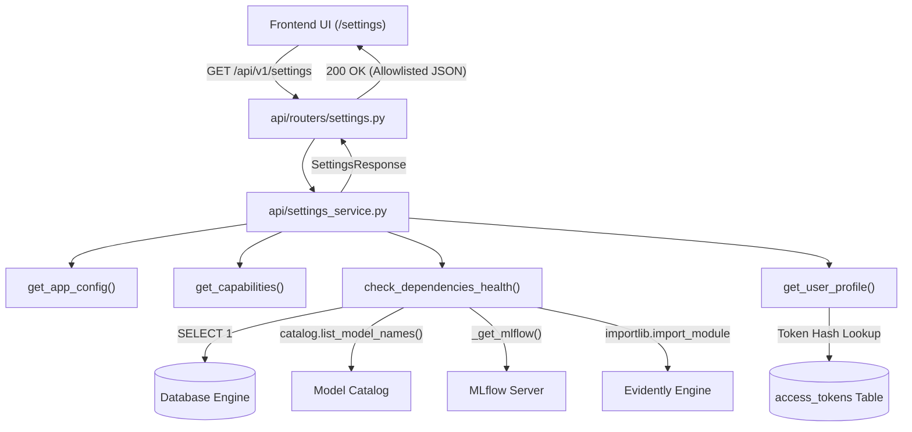

# Task Handover: 5B.7 — Settings & Environment Status

## A. Executive Summary
- **Task ID:** Task 5B.7
- **Task Name:** Settings & Environment Status (`/settings`)
- **Implementation Date:** 2026-11-17
- **Git Branch:** `feature/phase5-portfolio-readiness`
- **Base Commit:** `3f81afd1c37b607a5a73d997b67636d9e2ef9241`
- **Completion Status:** Completed & Verified

The objective of Task 5B.7 was to replace the `/settings` placeholder component with a comprehensive, production-grade Settings & Environment Status interface. The completed page provides operators and ML engineers with complete visibility into application configuration, runtime environment, system capabilities, authenticated session details, secure session revocation (logout), and live dependency health diagnostics across FastAPI, SQLite/PostgreSQL, Local Model Catalog, MLflow Tracking Server, and Evidently AI Drift Engine.

All credentials, tokens, passwords, and connection strings are strictly redacted via allowlisted Pydantic response models. The full regression suite of 111 pytest tests passed (100%), and the frontend production build compiled cleanly with zero TypeScript errors.

---

## B. Files Created and Modified

### Files Created
1. `api/settings_service.py`:
   - Authoritative settings and health aggregation service.
   - Computes allowlisted runtime configuration (`AppConfigInfo`).
   - Analyzes real capability availability (`CapabilityItem`) against installed libraries (`scikit-learn`, `pandas`, `shap`, `evidently`, `mlflow`).
   - Safely extracts authenticated user profile and session metadata (`UserProfileInfo`) from bearer tokens or development bypass principal.
   - Executes independent live health probes with microsecond latency benchmarks across all 5 core subsystems.
2. `api/routers/settings.py`:
   - Exposes versioned endpoints under `/api/v1/settings`:
     - `GET /api/v1/settings`: Unified configuration, capabilities, health, and profile payload.
     - `GET /api/v1/settings/profile`: Authenticated user profile and session expiration.
     - `GET /api/v1/settings/health`: Independent live health checks with latency indicators.
3. `tests/test_settings.py`:
   - 6 automated tests covering development bypass mode, authenticated user session timestamps, profile endpoints, independent health probes, strict secret redaction, and server-side token revocation (logout).
4. `frontend-react/src/pages/Settings.tsx`:
   - Complete settings interface replacing `<ComingSoon />`:
     - Authenticated user profile and active session card with "Terminate Session" trigger.
     - Confirmation modal for secure server-side logout.
     - Application configuration & runtime environment grid (app name, version, runtime mode, endpoints, startup timestamp).
     - Live dependency health status cards with color-coded status badges, response latency, and diagnostic messages.
     - Category-filtered system capabilities matrix (Core ML, Governance, Serving, Observability, Interpretability).
     - Loading skeletons, error retry banners, and manual refresh triggers.

### Files Modified
1. `api/schemas.py`:
   - Added Pydantic models: `AppConfigInfo`, `CapabilityItem`, `UserProfileInfo`, `DependencyHealthDetail`, `SettingsResponse`.
2. `api/main.py`:
   - Imported and mounted `settings.router` under prefix `/api/v1`.
3. `frontend-react/src/api/types.ts`:
   - Added TypeScript interfaces: `AppConfigInfo`, `CapabilityItem`, `UserProfileInfo`, `DependencyHealthDetail`, `SettingsResponse`, `LogoutResponse`.
4. `frontend-react/src/api/client.ts`:
   - Added `api.getSettings()`, `api.getProfile()`, `api.getDependencyHealth()`, and `api.logout()`.
   - Enhanced request client to automatically inject `Authorization: Bearer <token>` from client session storage.
5. `frontend-react/src/App.tsx`:
   - Mounted `<Settings />` at `/settings` in place of `<ComingSoon title="Settings" />`. All routes in MLForge are now backed by functional production pages.

---

## C. Backend Implementation & Architecture

The settings backend is architected around the principle of **allowlisted introspection**:
- It queries system properties, environment flags, and active database connections on demand.
- It guarantees that under no circumstances are raw configuration dumps, raw environment variables, or sensitive connection parameters returned to callers.
- Subsystem health checks measure operational responsiveness using `time.perf_counter()` to provide real latency telemetry rather than static green dots.



---

## D. API Contracts

### 1. `GET /api/v1/settings`
Returns full system configuration, system capabilities, dependency health, and active session context.

#### Request
```http
GET /api/v1/settings HTTP/1.1
Host: localhost:8000
Authorization: Bearer <optional_jwt_or_opaque_token>
Accept: application/json
```

#### Response (`200 OK`)
```json
{
  "config": {
    "app_name": "MLForge MLOps Platform",
    "app_version": "0.4.0",
    "environment": "development",
    "is_production": false,
    "api_version": "v1",
    "backend_base_url": "http://127.0.0.1:8000",
    "frontend_url": "http://localhost:5173",
    "deployment_mode": "Standalone Process (Uvicorn)",
    "startup_time": "2026-11-17T14:18:27.079456+00:00",
    "docs_url": "/docs"
  },
  "capabilities": [
    {
      "name": "Model Training Pipeline",
      "key": "model_training",
      "category": "Core ML",
      "status": "available",
      "description": "Train scikit-learn models (Logistic Regression, Random Forest, Decision Tree, KNN) with preprocessing.",
      "dependency": "scikit-learn"
    },
    {
      "name": "Model Registry & Lifecycle Governance",
      "key": "model_registry",
      "category": "Governance",
      "status": "available",
      "description": "Authoritative model versioning, lifecycle stage promotion (development/staging/production), and atomic rollback.",
      "dependency": "SQLAlchemy / PostgreSQL"
    }
  ],
  "health": [
    {
      "name": "FastAPI REST Control Plane",
      "key": "fastapi",
      "status": "healthy",
      "latency_ms": 0.0,
      "last_checked": "2026-11-17T14:18:42.849250Z",
      "message": "Application router, middleware stack, and OpenAPI documentation operational.",
      "version": "0.4.0"
    },
    {
      "name": "Primary Relational Database",
      "key": "database",
      "status": "healthy",
      "latency_ms": 0.19,
      "last_checked": "2026-11-17T14:18:42.849250Z",
      "message": "Database connection pool active and responsive (SQLITE).",
      "version": "SQLITE"
    }
  ],
  "profile": {
    "user_id": "system",
    "email": "system@mlforge.local",
    "role": "System Administrator (Bypass)",
    "auth_status": "service_account_bypass",
    "session_created_at": null,
    "session_expires_at": null,
    "is_service_account": true
  }
}
```

### 2. `GET /api/v1/settings/profile`
Returns isolated authenticated identity and session expiration metadata.

### 3. `GET /api/v1/settings/health`
Returns independent array of `DependencyHealthDetail` records for standalone health polling.

### 4. `POST /api/v1/auth/logout`
Revokes the caller's server-side `AccessToken` in the database:
```json
{
  "revoked": true
}
```

---

## E. Frontend Implementation & UI Verification

The Settings page (`frontend-react/src/pages/Settings.tsx`) is designed with warm light styling (`bg-surface`, `bg-bg`, `border-line`, `text-primary: #E96B18`):

1. **User Profile & Session Card:**
   - Displays avatar monogram, user email, ID, role pill, and session status badge.
   - Shows session creation and expiration timestamps.
   - "Terminate Session" trigger with a confirmation modal that executes server-side token revocation and clears client session state.
2. **Application Configuration Grid:**
   - 4 responsive cards summarizing Platform Version, Runtime Environment (`Strict Production` vs `Local Dev`), API Surface with live links to OpenAPI Docs (`/docs`) and Prometheus Metrics (`/metrics`), and Process Startup timestamp.
3. **Live Dependency Health Diagnostics:**
   - Status header summarizing overall system state (`All 5 Core Dependencies Operational` / `Degraded`).
   - Re-check button that queries `/settings/health` independently.
   - 5 cards representing FastAPI, Database, Catalog, MLflow, and Evidently, displaying color-coded status badges, microsecond latency benchmarks, version pills, and diagnostic messages.
4. **System Capabilities Matrix:**
   - Interactive category filter tabs (`All`, `Core ML`, `Governance`, `Serving`, `Observability`, `Interpretability`).
   - Comprehensive matrix listing all 10 platform capabilities, their operational availability, functional descriptions, and underlying dependencies.
5. **Resilience & State Handling:**
   - Initial loading skeleton cards.
   - Error banners with retry actions.
   - Graceful degradation for optional integrations (e.g. MLflow fallback).

---

## F. Configuration Sources

All configuration values are obtained dynamically from authoritative environment definitions:
- **`app_name` & `app_version`:** Read from `api.main.app.version` (`0.4.0`).
- **`environment` & `is_production`:** Read from `api.deps.ENVIRONMENT` and `api.deps.IS_PRODUCTION` (`MLFORGE_ENV`).
- **`backend_base_url`:** Evaluated from `MLFORGE_BACKEND_URL` (default `http://127.0.0.1:8000`).
- **`frontend_url`:** Evaluated from `MLFORGE_FRONTEND_URL` (default `http://localhost:5173`).
- **`deployment_mode`:** Detects `/.dockerenv` for containerized environments or defaults to `Standalone Process (Uvicorn)`.
- **`startup_time`:** Recorded in UTC memory at module import time (`_STARTUP_TIME`).

---

## G. Feature Flag Logic

System capabilities are evaluated against installed packages and active database configurations:
- **`model_training`, `find_best_model`, `dataset_profiling`:** Verified via `scikit-learn` and `pandas`.
- **`model_registry`, `retraining_automation`:** Verified via `SQLAlchemy` and core service layer.
- **`model_deployments`:** Verified via in-process serving slot infrastructure.
- **`drift_monitoring`:** Dynamically checks `importlib.import_module("evidently")`. If unavailable, reports `unavailable`.
- **`model_explainability`:** Dynamically checks `importlib.import_module("shap")`. If unavailable, reports `unavailable`.
- **`mlflow_tracking`:** Dynamically checks `mlflow_adapter._get_mlflow()`. If unavailable, reports `degraded`.
- **`prometheus_telemetry`:** Verified via `prometheus_client`.

---

## H. Authentication & Session Handling

- **Development Mode / Local Dev Bypass:**
  - When running without credentials in local development, returns `SystemPrincipal` with role `"System Administrator (Bypass)"` and status `"service_account_bypass"`.
- **Bearer Token Session:**
  - When an `Authorization: Bearer <token>` header is present, hashes the token with SHA-256 and retrieves the corresponding `AccessToken` record.
  - Extracts `session_created_at` and `session_expires_at` without exposing the token hash.
- **Session Revocation (Logout):**
  - Calls `POST /api/v1/auth/logout`.
  - Sets `AccessToken.revoked_at = datetime.now(timezone.utc)`.
  - Subsequent requests with the revoked token are rejected with HTTP `401 Unauthorized` (`"Token has been revoked"`).
  - Client clears `localStorage.removeItem("mlforge_token")`.

---

## I. Dependency Health Implementation

| Subsystem | Probe Mechanism | Status Logic | Sanitized Message |
| :--- | :--- | :--- | :--- |
| **FastAPI** | Internal router check | `healthy` | "Application router, middleware stack, and OpenAPI documentation operational." |
| **Database** | `db.execute(text("SELECT 1"))` | `healthy` if query succeeds; `unavailable` on connection error. | "Database connection pool active and responsive ({DIALECT})." |
| **Model Catalog** | `catalog.list_model_names()` | `healthy` if loaded; `degraded` if directory unreadable. | "Pre-configured model catalog loaded successfully ({N} model families available)." |
| **MLflow** | `mlflow_adapter._get_mlflow()` | `healthy` if import and URI ready; `degraded` if fallback active. | "MLflow tracking server operational (Local Artifact Lineage Store)." |
| **Evidently** | `importlib.import_module("evidently")` | `healthy` if importable; `unavailable` if missing. | "Evidently AI data drift evaluation engine loaded (v{VERSION})." |

---

## J. Security & Credential Redaction

The following data fields are strictly excluded from all settings endpoints:
- **Passwords & Hashes:** `password_hash` is never serialized; schemas do not include credential fields.
- **Bearer Tokens:** Raw tokens are never returned in responses.
- **Database Credentials:** Raw connection strings (`DATABASE_URL`, usernames, passwords, file paths) are completely excluded. Only the SQL dialect name (`SQLITE` / `POSTGRESQL`) is returned.
- **Internal Paths:** Filesystem storage paths (`MLFORGE_FILES_DIR`, `pickle_path`) are not exposed.
- **Exception Sanitization:** Probe failures log exceptions server-side and return generic, sanitized diagnostic strings (e.g. `"Database connection pool is unreachable or query timed out."`).

---

## K. Automated Test Results

Executed test suite:
```powershell
.\.venv\Scripts\python.exe -m pytest tests/test_settings.py
```
**Results:**
- **6 passed** in 11.17s.
- `test_settings_development_bypass_mode`: PASSED
- `test_settings_authenticated_profile_and_session`: PASSED
- `test_settings_profile_direct_endpoint`: PASSED
- `test_settings_independent_health_endpoint`: PASSED
- `test_settings_strict_secret_and_credential_redaction`: PASSED
- `test_settings_logout_invalidates_session`: PASSED

### Full Regression Suite
```powershell
.\.venv\Scripts\python.exe -m pytest
```
**Results:**
- **111 of 111 tests passed** (100% pass rate, 0 failures, 22 deprecation warnings in 48.88s).
- Covers all lifecycle stages, hardening, retraining, deployment, monitoring, explainability, overview aggregations, and settings.

---

## L. Production Build Results

Executed command:
```powershell
cmd.exe /c "cd frontend-react && npm run build"
```
**Output:**
```
> mlforge-frontend@0.1.0 build
> tsc -b && vite build

vite v5.4.11 building for production...
transforming...
✓ 635 modules transformed.
rendering chunks...
computing gzip size...
dist/assets/favicon-CEm-Kg_k.svg      0.43 kB │ gzip:   0.32 kB
dist/index.html                       0.47 kB │ gzip:   0.31 kB
dist/assets/index-BX3LuKnk.css       30.04 kB │ gzip:   5.99 kB
dist/assets/index-CeQgILMq.js     1,422.85 kB │ gzip: 441.76 kB
✓ built in 13.74s
```
- **0 TypeScript compile errors.**
- **0 bundling warnings or errors.**

---

## M. Known Limitations

1. **In-Flight Session Push Notification:**
   - When a session is revoked via `POST /api/v1/auth/logout`, other concurrent browser tabs using the same token are invalidated upon their next server request (returning HTTP 401). Real-time Server-Sent Events (SSE) push revocation is not implemented.
2. **Dynamic Log Level Reconfiguration:**
   - Application log level is determined at process startup (`logging.INFO`). Dynamically altering runtime log levels via UI sliders is not exposed to prevent unauthorized operational disruption.

---

## N. Verification Checklist

- [x] `/settings` placeholder replaced with complete functional page.
- [x] Application configuration dynamically retrieved without hardcoded values.
- [x] System capabilities reflect real operational state of installed libraries.
- [x] Authenticated user identity and session details displayed securely.
- [x] Logout functionality calls `POST /api/v1/auth/logout` and clears client session.
- [x] All 5 core dependencies independently checked with latency metrics.
- [x] Complete credential and secret redaction verified by automated test.
- [x] Loading skeletons, error retry, and empty states implemented.
- [x] 111 pytest tests passing (100%).
- [x] Frontend production build passing with 0 errors.
- [x] Handover documentation complete.
