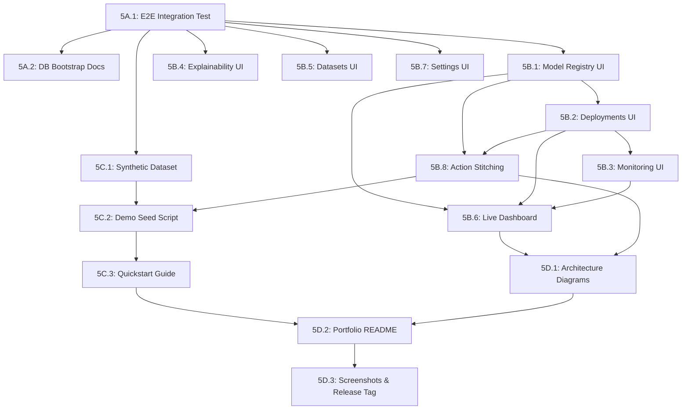

# MLForge — Phase 5: Portfolio Readiness & Product Polish
## Master Implementation Plan

- **Target Milestone:** Phase 5 — Portfolio Readiness & Product Polish
- **Product Nature:** Demonstrable Portfolio & Applied Research MLOps Application (Single-tenant / Developer-friendly; not a multi-tenant SaaS)
- **Author:** Senior Software Architect, MLOps Engineer & Technical Reviewer
- **Status:** Proposed Implementation Plan (Read-Only Assessment Complete)

---

## 1. Executive Summary

MLForge has progressed through four functional iterations (Phase 1 core platform, Phase 2 MLOps foundations, Phase 3 deployment & monitoring, and Phase 4 controlled automation). Across these phases, the **backend capabilities have been solidly implemented and rigorously tested** (94 unit and API tests passing in `pytest`, bidirectional Alembic migrations 0001–0005 verified, pip requirements clean with zero broken dependencies, and first-party warnings reduced to zero).

However, **there is a sharp asymmetry between the backend capability and the frontend surface**:
- The backend contains production-ready services for Model Registry (`api/registry_service.py`), Deployments & Real-time Serving (`api/deployment_service.py`), Data Drift Monitoring (`api/monitoring_service.py`, `api/integrations/evidently_adapter.py`), Explainability (`ml_core/explainability.py`), and Dataset Profiling (`ml_core/dataset_profile.py`).
- In contrast, the frontend still routes `/datasets`, `/registry`, `/deployments`, `/monitoring`, `/explainability`, and `/settings` to placeholder `ComingSoon` screens. The main `Overview` dashboard still displays hardcoded Phase 1 demo fixtures ("Demo data · Phase 2/3") despite real data existing in the database.

**The mission of Phase 5 is Portfolio Readiness & Product Polish.** Rather than introducing heavy enterprise infrastructure (e.g. Kubernetes, multi-tenant billing, or complex microservices), Phase 5 focuses on:
1. **Reliability & Integration (5A):** Verifying the complete end-to-end ML lifecycle from ingestion to retraining, adding full-chain regression tests, and documenting fresh database bootstrap procedures.
2. **Complete the Product Interface (5B):** Replacing all `ComingSoon` placeholders with clean, responsive, professional UI views backed by the existing backend APIs (Overview, Model Registry, Deployments, Monitoring, Explainability, Dataset Profiling, and Settings).
3. **Demonstration & Reproducibility (5C):** Providing clean synthetic sample datasets, an automated demonstration seed script, and step-by-step reproducible instructions for any reviewer or hiring manager to clone and run the application in under 3 minutes.
4. **Portfolio Presentation & Release (5D):** Authoring an architectural-grade README with system diagrams, ML lifecycle flowcharts, screenshots of the actual running application, and documented engineering trade-offs.

---

## 2. Verified Current Project State

### 2.1 Git Repository & Branch Topology
- **Current Branch:** `feature/phase4-controlled-automation`
- **HEAD Commit:** `3f81afd1` (`fix(retraining): enforce atomic promotion consistency, eliminate warnings, add regression tests`)
- **Parent Integration Branch:** `feature/phase3-deployment-monitoring` (at commit `e79cdca0`)
- **Relative Position:** Exactly 3 commits ahead of Phase 3, 0 commits behind.
- **Working Tree:** Clean of tracked modifications.
- **Untracked Artifacts:** `UIDesign/` (contains visual asset `MLForge-Refferance.png`).

### 2.2 Test & Build Verification (Independently Executed)
- **Pytest Suite:** **94 passed, 0 failed** in 43.68s.
  - `tests/test_api.py`: 8 tests (API key gate, error handling, batch predict, jobs listing, health checks, catalog reading, `SystemPrincipal` ownership normalization).
  - `tests/test_catalog.py`: 6 tests (catalog CSV loading, model capabilities).
  - `tests/test_deployment_monitoring.py`: 16 tests (deployment lifecycle, real-time JSON predict, rollback, stop, Evidently drift detection, Prometheus metrics).
  - `tests/test_hardening.py`: 24 tests (auth registration, token hash/expiry, per-owner registry isolation, transition graph, MLflow graceful degrade, SHAP explainability, dataset profiling).
  - `tests/test_phase2.py`: 6 tests (registry promotion, MLflow tracking).
  - `tests/test_preprocessing.py`: 3 tests (imputation, scaling, categorical encoding).
  - `tests/test_retraining.py`: 22 tests (manual candidate retraining, candidate evaluation, drift-triggered candidate generation, double-decision guard, stale champion detection, promotion failure rollback).
  - `tests/test_task_detection.py`: 5 tests (binary classification, multiclass, regression, integer target heuristics).
  - `tests/test_training.py`: 4 tests (single model training, evaluation metrics).
- **Alembic Migrations:** 0001 -> 0002 -> 0003 -> 0004 -> 0005 clean. Downgrade/re-upgrade verified against both fresh and pre-populated databases.
- **Frontend Build:** `tsc -b && vite build` passed cleanly with 0 TypeScript errors.
- **Pip Dependencies:** `python -m pip check` verified with "No broken requirements found."
- **Warnings Status:** Total warnings reduced from 1,039 down to 21. Zero first-party warnings. The 21 remaining warnings are internal to third-party packages (`mlflow` gateway validators and `starlette` testclient portal deprecation).

---

## 3. Existing Functionality Inventory

| Domain | Backend Service | API Router | Database Models | Frontend Status | Status Assessment |
|---|---|---|---|---|---|
| **Authentication & Accounts** | `api/auth.py` | `api/routers/auth.py` | `User`, `AccessToken` (SHA-256 hashed, 30d TTL) | No login/profile UI (`/settings` is ComingSoon) | Backend Complete; UI Missing |
| **Model Catalog** | `ml_core/catalog.py` | `api/routers/catalog_router.py` | Committed catalog CSVs | Dropdown in `/train` | Implemented & Functional |
| **Dataset Ingestion & Profiling** | `ml_core/dataset_profile.py`, `api/services.py` | `api/routers/datasets.py` | File uploads under `MLForge_files/` | `/datasets` is ComingSoon | Backend Complete; UI Missing |
| **Model Training & AutoML** | `ml_core/training.py`, `api/services.py` | `api/routers/training.py` | `Job` | `/train` & `/experiments` functional | Implemented & Functional |
| **Model Registry & Governance** | `api/registry_service.py` | `api/routers/registry.py` | `ModelVersion` (versioning, transitions, quality gate) | `/registry` is ComingSoon | Backend Complete; UI Missing |
| **Deployment Lifecycle** | `api/deployment_service.py` | `api/routers/deployments.py` | `Deployment`, `RequestLog` | `/deployments` is ComingSoon | Backend Complete; UI Missing |
| **Real-Time Inference** | `api/deployment_service.py` | `api/routers/deployments.py::predict_json` | `RequestLog` (latency, status) | None (only batch CSV `/predictions` exists) | Backend Complete; UI Missing |
| **Data Drift & Monitoring** | `api/monitoring_service.py`, `evidently_adapter.py` | `api/routers/deployments.py::monitor` | `MonitoringSnapshot` | `/monitoring` is ComingSoon | Backend Complete; UI Missing |
| **Explainability (SHAP)** | `ml_core/explainability.py` | `api/routers/explain.py` | Linked via `Job` | `/explainability` is ComingSoon | Backend Complete; UI Missing |
| **Controlled Retraining** | `api/retraining_service.py` | `api/routers/retraining.py` | `RetrainingCandidate` | `/pipelines` is functional | Implemented & Functional |
| **Audit & History** | `api/services.py`, `retraining_service.py` | `api/routers/jobs.py`, `.../audit` | `Job`, `RetrainingCandidate` | `/logs` functional; candidate audit functional | Implemented & Functional |
| **Observability (Metrics)** | `prometheus_metrics.py` | `/metrics` endpoint | Prometheus Counter & Histogram | None (scrape-ready) | Complete (Backend/Scrape) |

---

## 4. Frontend Completeness Assessment

### 4.1 Functional Routes
1. `/train` ([frontend-react/src/pages/TrainModel.tsx](file:///c:/Users/Aditya/Desktop/MLForge-main/MLForge-main/frontend-react/src/pages/TrainModel.tsx)): CSV upload, model selection, column inputs, in-process training. Output currently renders raw JSON.
2. `/experiments` ([frontend-react/src/pages/FindBestModel.tsx](file:///c:/Users/Aditya/Desktop/MLForge-main/MLForge-main/frontend-react/src/pages/FindBestModel.tsx)): AutoML candidate search, model ranking table.
3. `/predictions` ([frontend-react/src/pages/Predictions.tsx](file:///c:/Users/Aditya/Desktop/MLForge-main/MLForge-main/frontend-react/src/pages/Predictions.tsx)): Batch CSV inference against completed training jobs.
4. `/pipelines` ([frontend-react/src/pages/Retraining.tsx](file:///c:/Users/Aditya/Desktop/MLForge-main/MLForge-main/frontend-react/src/pages/Retraining.tsx)): Manual candidate trigger, evaluation, approval/rejection, audit display.
5. `/logs` ([frontend-react/src/pages/Logs.tsx](file:///c:/Users/Aditya/Desktop/MLForge-main/MLForge-main/frontend-react/src/pages/Logs.tsx)): Tabular audit view of all training and prediction jobs.

### 4.2 Non-Functional / Placeholder Routes (`ComingSoon.tsx`)
1. `/` (Overview / Dashboard): Displays hardcoded mock arrays (`DEMO_TRAINING_ACTIVITY`, `DEMO_MODEL_PERFORMANCE`) and static placeholders for Registered Models, Deployed Models, and Alerts.
2. `/datasets`: Placeholder for dataset profiling and validation heuristics.
3. `/registry`: Placeholder for Model Registry version management, promotion, and champion/challenger comparison.
4. `/deployments`: Placeholder for active model serving, deployment control (stop/rollback), and real-time inference.
5. `/monitoring`: Placeholder for Evidently drift snapshots and alerting history.
6. `/explainability`: Placeholder for SHAP global feature importance charts.
7. `/settings`: Placeholder for session state, API configuration, and environment status.

---

## 5. Backend Capability Assessment

The backend is mature and feature-complete for all core ML lifecycle stages:
1. **Database Schema:** 8 database models covering users, tokens, jobs, registry versions, deployments, request logs, monitoring snapshots, and retraining candidates.
2. **Architectural Authority:** ADR-0004 is strictly enforced. The model registry (`registry_service.py`) is the sole authority on lifecycle state (`development`, `staging`, `production`, `archived`). Retraining candidates cannot bypass the registry.
3. **Serving Layer:** In accordance with ADR-0005, model serving is embedded directly inside FastAPI (`api/deployment_service.py`), eliminating external Kubernetes/Triton dependencies while capturing real-time latency and request metrics.
4. **Resilience & Graceful Degradation:** Integrations with MLflow, SHAP, Evidently, and Prometheus are defensively wrapped in adapter layers. If an external telemetry tool is unavailable, the application records honest status values (`unavailable` or `error`) and allows training/serving to proceed uninterrupted.

---

## 6. Identified Integration Gaps

1. **Gap 1: Missing Registry UI & Disconnected Training Flow**
   - After a model completes training in `/train` or `/experiments`, the user cannot register it from the UI. There is no Model Registry view to inspect versions, promote to staging/production, or perform rollbacks.
2. **Gap 2: Disconnected Deployment & Serving Flow**
   - The backend `/api/v1/deployments` endpoints support deploying staging/production models, running single-record JSON inference with microsecond latency logging, and rolling back to previous deployments. None of this is accessible from the frontend.
3. **Gap 3: Drift-to-Retraining Disconnect in UI**
   - Backend endpoint `POST /api/v1/retraining/from-snapshot/{id}` allows generating a candidate from a drift alert. However, because `/monitoring` is a placeholder, a user cannot view drift reports or trigger retraining from drift without manual curl requests.
4. **Gap 4: Disconnected Explainability**
   - SHAP feature importances computed by `GET /api/v1/jobs/{id}/explain` are never visualized in the frontend.
5. **Gap 5: Outdated Dashboard Metrics**
   - `/` displays static demo data instead of aggregating real database counts (registered models, active deployments, drift alerts, recent jobs).
6. **Gap 6: Missing Demonstration Seed Data & Instructions**
   - The repository lacks a clean, dedicated sample dataset (e.g. `customer_churn.csv`) and an automated demonstration script to allow reviewers to immediately populate and observe the end-to-end lifecycle.

---

## 7. Phase 5 Implementation Breakdown (5A–5D)

```mermaid
flowchart TD
    subgraph Phase5A["Phase 5A: Reliability & Integration Baseline"]
        T5A1["Task 5A.1: End-to-End Lifecycle Integration Test"]
        T5A2["Task 5A.2: DB Bootstrap & Migration Documentation"]
    end

    subgraph Phase5B["Phase 5B: Complete the Product Interface"]
        T5B1["Task 5B.1: Dataset Profiling & Validation View (/datasets)"]
        T5B2["Task 5B.2: Model Registry View (/registry)"]
        T5B3["Task 5B.3: Deployments & Real-Time Inference View (/deployments)"]
        T5B4["Task 5B.4: Monitoring & Drift Reports View (/monitoring)"]
        T5B5["Task 5B.5: Explainability Visualizer (/explainability)"]
        T5B6["Task 5B.6: Live Operational Dashboard (/overview)"]
        T5B7["Task 5B.7: Settings & Environment Status View (/settings)"]
        T5B8["Task 5B.8: Workflow Stitching & Action Navigation"]
    end

    subgraph Phase5C["Phase 5C: Demonstration & Reproducibility"]
        T5C1["Task 5C.1: Synthetic Demonstration Dataset & Drift Window"]
        T5C2["Task 5C.2: Automated Seed & Demo Walkthrough Script"]
        T5C3["Task 5C.3: Reproducible Quickstart Guide"]
    end

    subgraph Phase5D["Phase 5D: Portfolio Presentation & Release"]
        T5D1["Task 5D.1: Architectural Diagrams & Lifecycle Flowcharts"]
        T5D2["Task 5D.2: Portfolio README Rebuild"]
        T5D3["Task 5D.3: Application Screenshot Pack & Milestone Release"]
    end

    Phase5A --> Phase5B
    Phase5B --> Phase5C
    Phase5C --> Phase5D
```

---

### Detailed Task Specification

#### Phase 5A — Reliability & Integration Baseline

| Task ID | Description | Existing State | Files Affected | Dependencies | Acceptance Criteria | Priority |
|---|---|---|---|---|---|---|
| **5A.1** | Author comprehensive end-to-end lifecycle integration test covering dataset upload → train → register → deploy → predict_json → monitor_drift → drift_retrain → evaluate → approve → promote → rollback. | **Completed & Verified** (`tests/test_e2e_lifecycle.py` — 5 tests passing: happy-path 12-step lifecycle, cross-user isolation, promotion rollback, non-alerting refusal, evaluation/approval guards). | `tests/test_e2e_lifecycle.py` | None | Full test passes in pytest without mocks, exercising real database transactions and service integrations. | **Critical** |
| **5A.2** | Verify and document database initialization, fresh bootstrap, and migration consistency for fresh clones. | Alembic 0001–0005 tested; `init_db()` vs `alembic upgrade head` documentation needs formal unification. | `docs/architecture/database.md`, `README.md` | None | Documented fresh database bootstrap runs cleanly without manual schema intervention. | **High** |

#### Phase 5B — Complete the Product Interface

| Task ID | Description | Existing State | Files Affected | Dependencies | Acceptance Criteria | Priority |
|---|---|---|---|---|---|---|
| **5B.1** | Implement Dataset Profiling UI page (`/datasets`) with CSV dropzone, column types, missingness, duplicate detection, class imbalance, and leakage warnings. | **Completed & Verified** (`frontend-react/src/pages/Datasets.tsx` — drag-and-drop profiler, quality metrics, leakage warnings, class imbalance badges, workspace dataset history). | `frontend-react/src/pages/Datasets.tsx`, `frontend-react/src/api/client.ts`, `frontend-react/src/api/types.ts`, `frontend-react/src/App.tsx` | 5A.1 | Uploading a CSV displays comprehensive dataset quality cards, column breakdown, and leakage warnings. | **Critical** |
| **5B.2** | Implement Model Registry UI page (`/registry`) with version tables, lifecycle tags, promotion modal, rollback actions, and challenger comparison. | **Completed & Verified** (`frontend-react/src/pages/ModelRegistry.tsx` — KPI counters, version table, details inspection modal, champion/challenger comparison, promotion/rollback modals, training job registration). | `frontend-react/src/pages/ModelRegistry.tsx`, `frontend-react/src/api/client.ts`, `frontend-react/src/api/types.ts`, `frontend-react/src/App.tsx` | 5A.1 | Users can view all model versions, promote across stages, rollback production, and compare champion/challenger. | **Critical** |
| **5B.3** | Implement Deployments & Inference UI page (`/deployments`) with active deployment list, deployment actions (deploy, stop, rollback), live latency metrics, and real-time JSON prediction tester. | **Completed & Verified** (`frontend-react/src/pages/Deployments.tsx` — serving slots table, metrics observability, deploy modal, real-time JSON inference playground, stop/rollback dialogs). | `frontend-react/src/pages/Deployments.tsx`, `frontend-react/src/api/client.ts`, `frontend-react/src/api/types.ts`, `frontend-react/src/App.tsx` | 5B.2 | Users can deploy staging/production models, stop/rollback deployments, and test single-record JSON inference with latency feedback. | **Critical** |
| **5B.4** | Implement Monitoring UI page (`/monitoring`) with snapshot history, drift scores, Evidently feature-level drift table, and "Trigger Retraining" quick-action. | **Completed & Verified** (`frontend-react/src/pages/Monitoring.tsx` — KPI summary, searchable/filterable snapshot history, drift evaluation window upload, detailed snapshot inspection modal, feature drift analysis, drift-to-retraining candidate generation). | `frontend-react/src/pages/Monitoring.tsx`, `frontend-react/src/api/client.ts`, `frontend-react/src/api/types.ts`, `frontend-react/src/App.tsx` | 5B.3 | Users can upload inference window CSVs, view drift metrics, and generate retraining candidates directly from alerts. | **Critical** |
| **5B.5** | Implement Explainability UI page (`/explainability`) visualizing global SHAP feature importance for trained models with informative engineering disclaimers. | **Completed & Verified** (`frontend-react/src/pages/Explainability.tsx` — KPI summary, model/version selector with stage filters, Apache ECharts horizontal bar chart, ranked feature table, split/chart/table view modes, causality disclaimer, unsupported algorithm guidance). | `frontend-react/src/pages/Explainability.tsx`, `frontend-react/src/api/client.ts`, `frontend-react/src/api/types.ts`, `frontend-react/src/App.tsx`, `frontend-react/src/pages/ModelRegistry.tsx`, `frontend-react/src/pages/TrainModel.tsx` | 5A.1 | Displays sorted horizontal bar chart of mean absolute SHAP values with graceful degradation for unsupported models. | **High** |
| **5B.6** | Refactor Dashboard (`/`) to eliminate all mock arrays and render live operational metrics aggregated from backend queries. | **Completed & Verified** (`api/overview_service.py`, `api/routers/overview.py`, `tests/test_overview.py`, `frontend-react/src/pages/Overview.tsx` — live KPI counts, lifecycle distribution bar, 14-day training activity line chart, model performance leaderboard, active vs resolved drift alerts, and real health probes; all static mock arrays removed). | `api/overview_service.py`, `api/routers/overview.py`, `api/schemas.py`, `api/main.py`, `tests/test_overview.py`, `frontend-react/src/pages/Overview.tsx`, `frontend-react/src/api/types.ts`, `frontend-react/src/api/client.ts`, `frontend-react/src/components/ui/Card.tsx` | 5B.2, 5B.3, 5B.4 | Displays real counts for models, experiments, active deployments, drift alerts, and system health status. | **High** |
| **5B.7** | Implement Settings & Environment Status UI page (`/settings`) displaying current user session, API configuration, service dependencies, and health checks. | **Completed & Verified** (`api/settings_service.py`, `api/routers/settings.py`, `tests/test_settings.py`, `frontend-react/src/pages/Settings.tsx` — live allowlisted configuration, capability matrix, user session profile with server-side logout revocation, and microsecond latency health checks across all 5 core dependencies). | `api/settings_service.py`, `api/routers/settings.py`, `api/schemas.py`, `api/main.py`, `tests/test_settings.py`, `frontend-react/src/pages/Settings.tsx`, `frontend-react/src/api/types.ts`, `frontend-react/src/api/client.ts`, `frontend-react/src/App.tsx` | 5A.1 | Shows session details, API base URL, service health (SQLite, MLflow, Evidently), and token status. | **Medium** |
| **5B.8** | Stitch workflows across pages (e.g. "Register in Registry" button on completed training jobs; "Deploy" button on production registry versions). | Users must manually navigate between disconnected pages after completing actions. | `frontend-react/src/pages/TrainModel.tsx`, `frontend-react/src/pages/FindBestModel.tsx`, `frontend-react/src/pages/Retraining.tsx` | 5B.2, 5B.3 | Actions provide intuitive forward links to the next lifecycle stage. | **Medium** |

#### Phase 5C — Demonstration & Reproducibility

| Task ID | Description | Existing State | Files Affected | Dependencies | Acceptance Criteria | Priority |
|---|---|---|---|---|---|---|
| **5C.1** | Create clean synthetic sample dataset (`customer_churn_train.csv`) and drifted inference window (`customer_churn_drift.csv`). | Legacy sample datasets in `MLForge_files/` have non-intuitive filenames (e.g. `G10_L1_attendance`). | `sample_data/customer_churn_train.csv`, `sample_data/customer_churn_drift.csv`, `sample_data/customer_churn_predict.json` | None | Clean CSVs with documented feature schemas representing a realistic business scenario. | **High** |
| **5C.2** | Author automated demonstration seed script (`scripts/seed_demo.py`) that runs the full lifecycle in under 30 seconds via API. | No automated seed script exists; populating the platform requires manual UI interaction. | `scripts/seed_demo.py` | 5A.1, 5C.1 | Running `python scripts/seed_demo.py` trains models, registers v1/v2, creates a deployment, generates a drift alert, and creates a retraining candidate. | **High** |
| **5C.3** | Author comprehensive Quickstart & Demo Walkthrough guide with exact CLI commands for backend, frontend, and demo verification. | Quickstart instructions in `README.md` are outdated (marked Phase 2 in progress). | `docs/quickstart.md`, `docs/demo-walkthrough.md` | 5C.2 | A new developer can clone the repo and complete the walkthrough without encountering unstated prerequisites. | **High** |

#### Phase 5D — Portfolio Presentation & Release

| Task ID | Description | Existing State | Files Affected | Dependencies | Acceptance Criteria | Priority |
|---|---|---|---|---|---|---|
| **5D.1** | Author high-resolution system architecture diagrams, ML lifecycle flowcharts, and promotion governance diagrams using Mermaid. | Basic textual ADRs exist in `docs/adr/`; missing visual architecture diagrams. | `docs/architecture/system-architecture.md`, `README.md` | 5B.8 | Diagrams accurately represent the implemented system, storage layers, and governance boundaries. | **High** |
| **5D.2** | Rebuild root `README.md` into an executive, portfolio-grade presentation with badges, architecture overview, screenshots, and engineering trade-offs. | `README.md` still contains outdated Phase 2 disclaimers and unverified status notes. | `README.md` | 5C.3, 5D.1 | Professional README suitable for GitHub pinning, recruiters, and engineering interviewers. | **Critical** |
| **5D.3** | Capture application screenshots of functional views, verify production build, tag Phase 5 release milestone. | No UI screenshots exist in the repository; only untracked reference mockup exists. | `docs/assets/screenshots/*`, `CHANGELOG.md`, `docs/implementation-status.md` | 5B.1–5B.7, 5D.2 | High-fidelity screenshots reflecting the live application embedded in README and documentation. | **High** |

---

## 8. Exact Files Likely to be Modified or Created

### Backend Files
- `tests/test_e2e_lifecycle.py` (New): Full-lifecycle integration test.
- `scripts/seed_demo.py` (New): Automated demo seed and walkthrough script.
- `sample_data/customer_churn_train.csv` (New): Clean sample training dataset.
- `sample_data/customer_churn_drift.csv` (New): Clean drifted inference window.
- `sample_data/customer_churn_predict.json` (New): Sample JSON inference payload.

### Frontend Files
- `frontend-react/src/api/types.ts`: Add TypeScript definitions for Deployments, Metrics, Drift Snapshots, Dataset Profiles, Explainability, and Registry Actions.
- `frontend-react/src/api/client.ts`: Expose typed client methods for all existing backend endpoints.
- `frontend-react/src/App.tsx`: Wire new functional page routes replacing `ComingSoon`.
- `frontend-react/src/pages/Overview.tsx`: Refactor to query live aggregated metrics.
- `frontend-react/src/pages/ModelRegistry.tsx` (New): Model version management and promotion view.
- `frontend-react/src/pages/Deployments.tsx` (New): Deployment management and real-time prediction view.
- `frontend-react/src/pages/Monitoring.tsx` (New): Evidently drift reports and retraining trigger view.
- `frontend-react/src/pages/Explainability.tsx` (New): SHAP feature importance visualization.
- `frontend-react/src/pages/Datasets.tsx` (New): Dataset profiling and leakage analysis view.
- `frontend-react/src/pages/Settings.tsx` (New): System configuration and session view.
- `frontend-react/src/pages/TrainModel.tsx`: Add post-training action buttons (e.g. "Register in Model Registry").
- `frontend-react/src/pages/FindBestModel.tsx`: Add "Register Best Model" action button.

### Documentation Files
- `README.md`: Modern portfolio rebuild.
- `docs/quickstart.md` (New): Clean reproducible developer setup guide.
- `docs/demo-walkthrough.md` (New): End-to-end evaluation walkthrough.
- `docs/architecture/system-architecture.md` (New): System diagrams and lifecycle flows.
- `docs/implementation-status.md`: Updated traceability matrix marking Phase 5 complete.
- `CHANGELOG.md`: Record Phase 5 release milestone.

---

## 9. Existing APIs Reused vs. New APIs Required

### Existing APIs Reused (No Backend Changes Needed)
1. `GET /api/v1/health`: System health and dependency state.
2. `GET /api/v1/models`: Model catalog.
3. `POST /api/v1/train-model`: Single model fitting.
4. `POST /api/v1/find-best-model`: AutoML candidate search.
5. `POST /api/v1/predict`: Batch CSV prediction.
6. `GET /api/v1/jobs` & `GET /api/v1/jobs/{id}`: Job execution history and details.
7. `POST /api/v1/datasets/profile`: Dataset profiling and leakage warnings.
8. `GET /api/v1/registry`: Model version listing.
9. `POST /api/v1/registry/{job_id}/register`: Version registration.
10. `POST /api/v1/registry/{version_id}/promote`: Lifecycle state transitions (`staging`, `production`, `archived`).
11. `POST /api/v1/registry/{version_id}/rollback`: Production rollback.
12. `GET /api/v1/registry/compare`: Champion vs challenger metrics comparison.
13. `GET /api/v1/deployments`: Deployment listing.
14. `POST /api/v1/deployments/{version_id}/deploy`: Model deployment.
15. `GET /api/v1/deployments/{id}`: Deployment status and real-time latency metrics.
16. `POST /api/v1/deployments/{id}/rollback` & `.../stop`: Deployment rollback and termination.
17. `POST /api/v1/deployments/{id}/predict`: Real-time JSON inference.
18. `POST /api/v1/deployments/{id}/monitor` & `GET .../monitoring`: Evidently drift checks and snapshot history.
19. `GET /api/v1/jobs/{id}/explain`: SHAP global feature importances.
20. `POST /api/v1/retraining/trigger`: Manual retraining candidate creation.
21. `POST /api/v1/retraining/from-snapshot/{id}`: Drift-triggered candidate generation.
22. `POST /api/v1/retraining/{id}/evaluate`: Candidate vs champion evaluation.
23. `POST /api/v1/retraining/{id}/approve` & `.../reject`: Human approval/rejection gates.
24. `GET /api/v1/retraining/{id}/audit`: Full lineage resolution.
25. `GET /metrics`: Prometheus telemetry metrics.

### New APIs Required
**Zero new APIs are required.** The existing backend routers cover 100% of the functionality needed for Phase 5. Phase 5 is purely an integration, UI surface completion, and documentation milestone.

---

## 10. Database Schema Changes Required

**Zero new migrations or schema changes are required.** Migration `0005_retraining_candidates.py` represents the final schema state for MLForge v2.0. The existing 8 tables (`users`, `access_tokens`, `jobs`, `model_versions`, `deployments`, `request_logs`, `monitoring_snapshots`, `retraining_candidates`) support all required workflows.

---

## 11. Testing & Verification Strategy

1. **Phase 5A Baseline Gate:** Run `pytest` and Alembic downgrade/upgrade verification before writing UI components. Add `tests/test_e2e_lifecycle.py` to continuously verify the complete multi-step lifecycle in one test script.
2. **Frontend Component & Build Verification:** Execute `tsc -b && vite build` after authoring each page. Verify that bundle sizes are monitored and no typing regressions occur.
3. **Live Browser Smoke Testing:** Start the backend (`uvicorn`) and frontend (`vite dev`), and execute the full walkthrough through the browser:
   - Ingest `customer_churn_train.csv` and inspect profile at `/datasets`.
   - Train model at `/train` and register in registry at `/registry`.
   - Promote model to `production` and deploy at `/deployments`.
   - Execute real-time prediction at `/deployments`.
   - Upload `customer_churn_drift.csv` at `/monitoring` and generate retraining candidate.
   - Evaluate, approve, and promote candidate at `/pipelines`.
   - Verify audit chain at `/logs` and live stats on `/`.

---

## 12. UI/UX Implementation Strategy

### Design Language & Aesthetic Guidelines
- **Palette:** Clean, light business palette following existing CSS variables (`bg`: `#FBF9F7`, `surface`: `#FFFFFF`, `ink`: `#1A1612`, `muted`: `#7D756D`, `line`: `#EAE4DC`, `primary`: `#E96B18`, `amber`: `#D97706`).
- **Typography:** Modern clean sans-serif typography with strict hierarchy (`text-[28px] font-bold` for titles, `text-sm font-medium` for subheaders, `font-mono text-xs` for IDs and code).
- **Component Reusability:** Leverage existing `Card`, `CardHeader`, and `Icon` primitives.
- **Charts:** Use `EChart` wrapper for consistent data visualizations (feature importance bar charts, training activity area charts).
- **Feedback & States:** Every table must include clear loading indicators, empty states ("No deployments yet — deploy a model to get started"), and formatted error alerts.

---

## 13. Demonstration & Reproducibility Strategy

1. **Synthetic Sample Data (`sample_data/`):**
   - Provide a realistic 500-row `customer_churn_train.csv` (features: `age`, `tenure`, `monthly_charges`, `contract`, `internet_service`, target: `churn`).
   - Provide a shifted 100-row `customer_churn_drift.csv` (simulating senior demographic shift to trigger Evidently feature drift).
   - Provide a `customer_churn_predict.json` payload for immediate curl or UI inference testing.
2. **Automated Seed Script (`scripts/seed_demo.py`):**
   - Standalone Python script requiring only `requests`.
   - Creates a test user, trains a Logistic Regression and Random Forest model, registers the best model, promotes it to production, creates an active deployment, sends 10 sample predictions, executes a drift evaluation, and triggers a retraining candidate.
   - Reviewers can run `python scripts/seed_demo.py` to instantly populate the platform with rich, interconnected demonstration data.

---

## 14. Documentation & Release Strategy

1. **Root `README.md` Rebuild:**
   - Hero header with badges (Python 3.12, FastAPI, React 18, Vite, TypeScript, Pytest 94/94, Alembic).
   - Problem statement: Why self-service MLOps matters and what architectural challenges it solves.
   - System Architecture Diagram & ML Lifecycle Diagram.
   - Core Features Walkthrough with real screenshots.
   - Reproducible 3-step Quickstart guide (Local & Docker Compose).
   - Documented Engineering Trade-offs (e.g. Model Registry as promotion authority, Retraining Candidate as audit ledger, Human-in-the-loop requirement, SQLite vs Postgres rationale).
   - Documented Known Limitations (e.g. drift retraining reuses original dataset; in-process execution).

---

## 15. Task Dependencies & Execution Flow

---

## 16. Risks and Mitigations

| Risk | Impact | Likelihood | Mitigation Strategy |
|---|---|---|---|
| **Scope Creep / Endless Feature Loop** | High | Medium | Enforce strict phase-gating. Do not introduce new backend frameworks or SaaS infrastructure. Every task has explicit acceptance criteria. |
| **Frontend Bundle Size Growth** | Low | Medium | Keep dependencies lean (reuse existing ECharts, Tailwind, Lucide SVG icons). Only introduce route code-splitting if bundle size impedes loading. |
| **Third-Party Telemetry Failures during Demo** | Medium | Low | All external libraries (MLflow, Evidently, SHAP) are already wrapped in graceful-degrade adapters that log honest status values without crashing. |
| **Port Conflicts during Reviewer Evaluation** | Medium | Medium | Document configurable ports for both backend (`8000`) and frontend (`5173`) in `.env.example` and Quickstart documentation. |

---

## 17. Explicitly Deferred Backlog

The following items are outside the scope of Phase 5 and are documented in `docs/backlog.md`:
- **PostgreSQL Migration:** Connection string and dialect testing (SQLite is fully adequate for portfolio and single-tenant demonstration).
- **Redis + RQ Background Worker:** Asynchronous training queue (in-process training is sufficient for sample tabular models).
- **Artifact & Dataset Retention Daemon:** Automated background file purger.
- **Advanced Token Rotation & Multi-Tenant RBAC:** Refresh tokens and organization hierarchies.
- **Enterprise SaaS Features:** Billing, subscription tiers, multi-region routing.
- **Drifted Window Training:** Retraining on the incoming drifted data window rather than the source dataset.

---

## 18. Phase-Specific Acceptance Criteria

### Phase 5A Acceptance Criteria
- [x] Automated end-to-end integration test (`tests/test_e2e_lifecycle.py`) runs in pytest and passes cleanly (5 tests passed in 11.34s).
- [ ] Fresh database creation and Alembic migration procedures are verified and documented.

### Phase 5B Acceptance Criteria
- [ ] No placeholder `ComingSoon` screens remain in the main navigation.
- [ ] `/registry`, `/deployments`, `/monitoring`, `/explainability`, `/datasets`, and `/settings` are fully functional and backed by real backend APIs.
- [ ] `/` (Dashboard) renders live metrics aggregated from the database with zero hardcoded mock arrays.
- [ ] Frontend builds with zero TypeScript errors (`tsc -b && vite build`).

### Phase 5C Acceptance Criteria
- [ ] `sample_data/customer_churn_train.csv` and `customer_churn_drift.csv` are present and documented.
- [ ] Running `python scripts/seed_demo.py` completes the end-to-end demonstration workflow in under 30 seconds.
- [ ] A new developer can follow `docs/quickstart.md` to run the application locally.

### Phase 5D Acceptance Criteria
- [ ] Root `README.md` is updated with high-resolution architecture diagrams, feature walkthroughs, engineering trade-offs, and live application screenshots.
- [ ] All Phase 5 deliverables are verified and committed on `feature/phase5-portfolio-readiness`.

---

## 19. Final Phase 5 Definition of Done

MLForge Phase 5 is considered **COMPLETE** when:
1. Every route in the sidebar navigation points to a functioning, production-styled screen.
2. An external reviewer can clone the repository, run the quickstart instructions, and execute the complete ML lifecycle without encountering errors or unstated prerequisites.
3. The automated test suite (`pytest`) and frontend build (`npm run build`) pass cleanly.
4. The README and documentation present a cohesive, professional software engineering and MLOps achievement suitable for technical leadership review.
